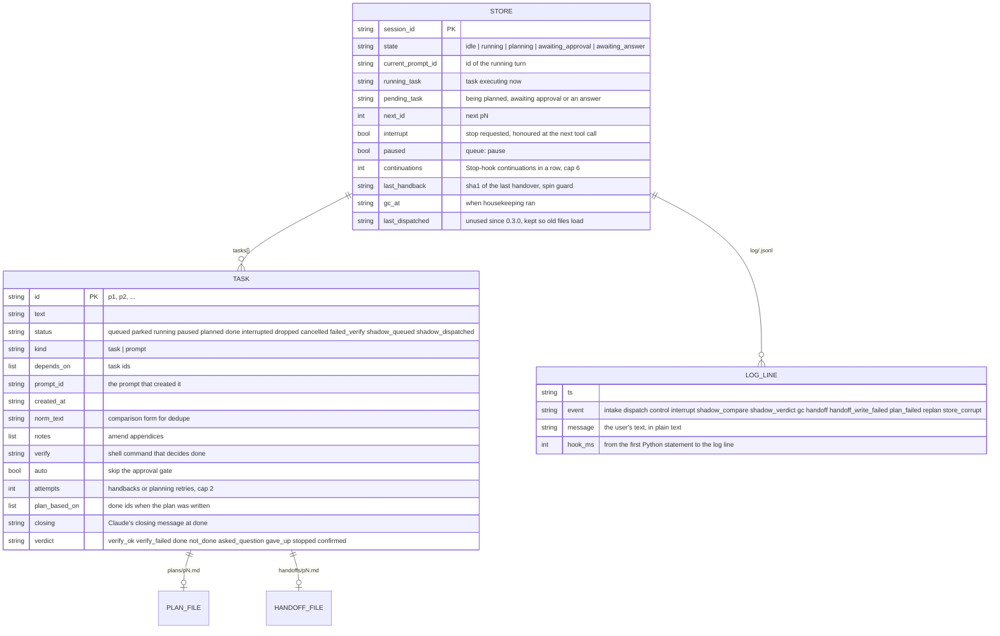

# queue-switchclaude

A plugin for Claude Code, Anthropic's terminal coding agent, that sorts the messages you type while Claude is still working. "Later: add tests" waits its turn instead of running now; "stop" ends the turn; "skip the tests" edits the task you already queued. Queued tasks run one after another, each with a short plan you approve first.

> **Experimental software, built in two days and tested on one machine.** It hooks into every prompt you send, every tool call Claude makes and every time Claude stops. When it misjudges a message it can hold back something you meant to be delivered now (you see a notice and the text comes back into the input box), end a turn you wanted to keep going, or keep Claude working for a few more turns than you expected. It spends model calls from your own Claude account (about one small call per message the rules cannot sort, and one per queued task closed without a test command). It never writes into the repository Claude is working in; everything it stores lives in one directory under `~/.claude` that you can delete at any time to reset. The author is not responsible for lost work, surprise turns or spent quota. If a session misbehaves, uninstall with the two commands under "Install" and the hooks are gone.

## Status (2026-10-19, version 0.4.1)

What is real, what is partial, and what does not exist. Every "real" row was exercised live in Claude Code 2.1.302 and the transcript of that run is in `docs/`.

| Capability | State | Evidence |
|---|---|---|
| Sorting a mid-run message into steer / queue / amend / split, with interrupt and parked flags | Real. A rule table decides the explicit forms (`later:`, `pN:`, `then …`, `after that …`, `stop`, `maybe later …`, `someday …`, `queue:`); everything else goes to a `haiku` call through `claude -p` | 44 of 47 golden cases, zero missed hard dependencies ([`docs/m1-eval.md`](docs/m1-eval.md)) |
| Queued tasks run after the current one, in dependency order | Real | [`docs/m0-acceptance.md`](docs/m0-acceptance.md) scenario A |
| Just-in-time plan per task, approval gate, handoff notes between tasks | Real | [`docs/m2-acceptance.md`](docs/m2-acceptance.md) |
| Done decided by a verify command, else by a `haiku` judge over Claude's closing message | Real; a failing verify is handed back twice, then the task is set aside | [`docs/m2-fixes-acceptance.md`](docs/m2-fixes-acceptance.md) |
| `stop` ends the turn | Real, but only at Claude's next tool call; a turn that is only writing text cannot be halted | [`docs/m0-acceptance.md`](docs/m0-acceptance.md) scenario B |
| Esc (you interrupt Claude yourself) drops the queue with a notice | Real, inferred from the next prompt's id, not from a signal; Esc during planning requeues instead | [`docs/m3-acceptance.md`](docs/m3-acceptance.md) |
| `queue:` control channel and `/queue` slash command | Real | [`docs/m1-acceptance.md`](docs/m1-acceptance.md) |
| Shadow mode (log only, block nothing) | Real | [`docs/m0-acceptance.md`](docs/m0-acceptance.md) scenario D, [`docs/m4-acceptance.md`](docs/m4-acceptance.md) |
| Background comparison of rule answers against the model while active (0.4.1) | Real, but checked only by hand in the installed plugin and by three unit tests; no written live record | `tests/test_compare.py` |
| Dependency inference | Partial: the model names `depends_on` when it answers; a rule-decided task, or one the model left without dependencies, chains after the last queued task, else the running one. That fallback also overrides a deliberately empty answer (golden cases g08 and g25 fail for this reason). There is no cycle check; a dependency on an unknown id is simply never satisfied | `scripts/qsc/intake.py`, `_chain_deps` |
| Amend target matching | Partial: standard-library word similarity ranks the candidates, the model picks among the top three; the embeddings pass the original design wanted was never built | `scripts/qsc/match.py` |
| Clearing held text from the input box after a block | Not possible from a hook; the text comes back and you clear it | Known limits |
| Offline, or no `claude` on `PATH` | Degrades without a message: a message the rules cannot sort passes through as steer after a wait of up to 15 s, and every queued task is closed as done when Claude stops (`judge unavailable; fail open`), so its dependants start. Verify commands still work | `scripts/qsc/model.py`, `done.py` |
| A hook that crashes | Exits 0 with no output, which Claude Code treats as "no plugin"; nothing tells you. On Windows a `python3` that is the Microsoft Store stub has the same effect: the script never starts (see Requirements) | `scripts/intake.py`, `dispatch.py`, `interrupt.py` |
| Native Windows | Partial: supported in the code (the store lock is `msvcrt.locking`, a verify command runs under `cmd.exe` and its process tree is killed with `taskkill`, `claude.cmd` from npm is found on `PATH`) and the suite passes on Windows in CI, but no live Claude Code session on Windows has run it yet. Needs a real `python3` on `PATH` | Requirements, `.github/workflows/test.yml` |
| Automated tests | 665 tests (a few run on one platform only), standard library only, a fake `claude` binary stands in for the model; CI runs them on Python 3.10, 3.12 and 3.14 on Ubuntu and on Python 3.12 on Windows, where a `claude.cmd` launcher around a Python fake stands in. CI does not run the golden-set eval or `claude plugin validate` | `.github/workflows/test.yml` |

Hard numbers that shape daily use, measured on the development machine (an Apple M4 Mac, Claude Code 2.1.302):

| | |
|---|---|
| Rule-decided message, hook cost | about 90 ms |
| Model-decided message, hook cost | 3.4 to 4.7 s |
| `stop` to the turn ending | about 2 s |
| Golden cases the rules decide alone | 8 of 47 |
| Hook timeouts in `hooks/hooks.json` | 25 s prompt, 5 s tool call, 180 s stop |

## Why it exists

Claude Code delivers anything you type while it is working straight into the running turn, as if you had said it in the middle of a sentence. That is right for "use bcrypt" and wrong for "when you're done, list the files": the second one runs now, in parallel with whatever Claude was doing, and nothing remembers it was meant for later. There is no native way to say "after this", "change the thing you have not started yet" or "stop".

The obvious alternatives, and what they do well:

- **Wait, then type.** Free, no moving parts, and you keep full control. It costs the thing you were about to say, and every run is a conversation you have to sit through.
- **A task file in the repository** that Claude reads at the end of each turn (the approach of the earlier claude-task-manager project, about 1,200 lines). Transparent and editable in any editor. But the file shows up in `git status`, nothing stops a message from being injected now anyway, and "done" means whatever Claude says it means.
- **Separate sessions in parallel worktrees.** The right answer for independent work; Claude Code supports it well. The wrong answer for "do B after A, using what A produced".
- **A router hook** that only tells steer from queue (the earlier Jev_steer_or_queue project, about 300 lines). Its hook tricks are now in the official hooks reference and are reused here; its queue was first-in-first-out with no plans, dependencies, amend or approval.

This plugin keeps the native behaviour for steering, and adds the three things the alternatives lack: a hold on messages meant for later, an order to run them in, and a check that each one actually finished before the next starts.

## Concepts

**A hook** is a program Claude Code runs at a fixed moment, handing it a JSON description of what is happening on standard input and reading a JSON answer on standard output. This plugin registers three: one when you submit a prompt (`UserPromptSubmit`), one before every tool call (`PreToolUse`), one when Claude stops (`Stop`). A hook can let the prompt through, block it with a message, add text that only Claude sees, or end the turn.

**A turn** is one run of Claude from your prompt to the point where it stops and waits. Claude Code tags every prompt with an id; a message typed while a turn is running carries the running turn's id, so the plugin can tell "typed mid-run" from "typed after Claude stopped" without guessing. When Claude stops, the Stop hook may hand it more text, which keeps the same turn going as a continuation; Claude Code allows at most eight of those in a row, and this plugin stops at six.

**The four classes.** Every mid-run message is one of: `steer` (applies to the work running now, delivered untouched), `queue` (a new task for later, held back and stored), `amend` (changes a task already in the queue: a note, a cancel, or a new dependency), or `split` (one message carrying two of those). Two flags ride on top: `interrupt` on a steer means stop now; `parked` on a queue means "maybe later", stored but never run until you promote it. Anything the plugin cannot sort is treated as `steer`, so the worst case is the native behaviour.

**A task** is a held message with an id (`p1`, `p2`, ... per session), the ids it depends on, and a status. Every turn you type yourself is also registered as a task (kind `prompt`) so queued work can chain after it, and gets a handoff file when it ends; that is why ids count your own prompts and why `queue: show p1` works on one. A prompt turn is never judged, only queued tasks are.

**The session state** says what the plugin is waiting for: `idle`, `running`, `planning` (Claude is writing a plan), `awaiting_approval` (a plan is on screen), `awaiting_answer` (Claude stopped by asking you something). The same words mean different things in different states: `ok` approves a plan while one waits and is ignored otherwise; `later: x` queues `x` while something runs and starts it now at idle.

**Plan and handoff.** When a queued task is ready, the Stop hook asks Claude to read the handoff of the task before it (what was produced, in Claude's own closing words) and write a short plan, then stop. You approve, revise or ignore it. When the task finishes, the plugin files its closing message as the next handoff. Both are markdown files under the plugin's data directory, never in your repository.

**Done.** A task you gave a verify command (`queue: verify p2 pytest -q`) is done when that command exits 0. Otherwise a small model call reads Claude's closing message and answers done, not done, or asked a question. "Not done" is handed back to Claude at most twice; after that the task is closed as done with verdict `gave_up`, nothing appears on screen, and whatever depends on it becomes ready. A failing verify command is instead set aside as `failed_verify` and you are told.

**Shadow mode** runs the whole pipeline and blocks nothing: every message is delivered as usual and the decision is logged with what would have happened. The judge still runs when a shadow-queued task's turn ends and handoff files are still written, so the log is a faithful rehearsal, at the same model cost. A second switch also asks the model about messages the rules decided, so the log shows where the two disagree.

## What a session looks like

Type a task. While Claude works on it, type `later: add a goodbye.py that prints goodbye`: the message is blocked, stored as `p2` after `p1`, and the notification says so. When Claude stops, the Stop hook closes `p1` (a turn you typed is simply `stopped`; a queued task is checked by its verify command if it has one, else by the judge, and a "not finished" verdict is handed back at most twice), writes `handoffs/p1.md`, and hands `p2` over for planning: Claude reads that handoff, writes `plans/p2.md`, presents it in a few lines and stops. Type `lgtm` (or `ok`, `yes`, `go`, `go ahead`, `do it`, `looks good`, `continue`, `ship it`, or `queue: approve`) and the plan runs, with `running p2` on screen; type `looks good but print the date first` and the plan is revised and shown again; type something unrelated and it runs as a normal turn, after which the plan is shown again. If a queued task's turn stops by asking a question, the next message is the answer and the task resumes; `ok, merge` instead confirms the task done (this applies to queued tasks only; a turn you typed is never judged, so it is never "waiting for an answer"). A task whose verify command fails twice is set aside as `failed_verify` and you are told; `queue: promote p2` retries it.

The rules know a few more markers than `later:`: a mid-run message starting with `pN:`, `then …`, `after that …`, or `once/when/after that's done …` is queued without a model call, and `someday …`, `at some point …`, `one day …` and `if we have time …` park like `maybe later …`.

When nothing is running, the markers mean what you would expect: `later: write i.txt` writes it now (the marker is stripped and the screen says `nothing was queued, running now: write i.txt`; if queued, planned, paused or failed-verify tasks are already waiting it is queued behind them instead, with a note saying so), `maybe later we can add a README` parks `p2` and nothing runs, and `stop` answers `nothing is running`. Pressing Esc while Claude writes a plan puts that task back in the queue, with its half-written plan deleted and nothing else dropped; whatever you type next runs as a normal turn and the task is planned again after it. Pressing Esc while a task is executing drops the queued tasks with a notice listing what was dropped (parked, planned, paused, failed-verify and done items survive). A typed `stop` resets the turn the same way, at the next tool call. A task that waited on a dropped, cancelled or interrupted one now waits on what that task waited on.

## The `queue:` control channel

A message starting with `queue:` runs one command against the queue and is answered in place, in every state, without a model call and without starting a turn. The slash forms `/queue <command>` and `/queue-switchclaude:queue <command>` are caught by the same rule before the slash command's own CLI runs; the bare form `queue <command>` (no colon) works when the first word is a known command.

| Command | Effect |
|---|---|
| `queue: list` | One line: the running, queued, parked, paused, planned and failed-verify tasks; the plan waiting on you reads `planned (awaiting approval)`; a paused queue says so |
| `queue: show pN` | `pN <status>: <text>`, plus the plan and handoff paths that exist, the verify command and `auto` when set |
| `queue: cancel pN` | A queued, parked, paused, planned or failed-verify task becomes `cancelled` |
| `queue: promote pN` | A parked, paused or failed-verify task returns to the queue |
| `queue: park pN` | A queued task becomes `parked` |
| `queue: pause` / `queue: resume` | Stop dispatching anything, or start again |
| `queue: resume pN` | Same as `promote` |
| `queue: drop` | Every queued and parked task becomes `dropped`; a planned task is left alone, cancel it by id |
| `queue: verify pN <command>` | The rest of the line, verbatim, decides done for `pN`: exit 0 on Stop means done, anything else is handed back with the output tail (120 s timeout; the command's process group is killed if it runs over). On Windows the command runs under `cmd.exe`, so write it in cmd syntax |
| `queue: auto pN` / `queue: manual pN` | Skip the approval gate for `pN` (its plan flows straight into execution), or wait for approval again |
| `queue: approve` | Run the plan that is waiting for approval; same as typing `lgtm`. `queue: approve pN` names the task |
| `queue: help` | The list above; so does any unknown word |

Task ids can be typed as `p2`, `P2` or `2`; a bare `queue` is `queue: list`. In shadow mode `cancel`, `park` and `drop` also act on the tasks shadow mode recorded. A failed command names every status it accepts (`p2 is not parked, paused or failed_verify`).

## The data model

One JSON file per Claude Code session holds the store below; the plan and handoff files sit next to it; the decision log is one JSON object per line. The exact field list is `scripts/qsc/store.py`.



"Ready" is not stored: a `queued` task whose every dependency is `done` is ready, in creation order. A missing, unparseable or wrongly shaped store file is treated as a fresh one and the corruption is logged, so a damaged file never crashes a hook. Files written by earlier versions load unchanged: new fields have defaults and unknown keys are ignored.

The constants that bound behaviour, from the code: classifier timeout 15 s, judge timeout 15 s, verify timeout 120 s, handbacks per task 2, continuations in a row 6, dedupe window 10 minutes, paste guard 150 words or 12 lines (such a message skips the rule table and goes to the model whole; the model may still split it), model confidence threshold 0.9, a not-done judge verdict below confidence 0.7 counts as done, amend matching accepts a score of 0.6 with a 0.2 margin over the runner-up and offers the top 3 candidates to the model, the classifier sees the last 4 turns from the last 64 KiB of the transcript, sessions untouched for 30 days are deleted.

## Architecture

```
hooks/hooks.json
  UserPromptSubmit  -> scripts/intake.py    -> qsc.intake
  PreToolUse        -> scripts/interrupt.py -> qsc.interrupt
  Stop              -> scripts/dispatch.py  -> qsc.dispatch
commands/queue.md   -> scripts/queue_cli.py -> qsc.control   (fallback only; the rule answers first)
scripts/compare.py  -> qsc.classify          (detached, background comparison)

qsc.intake    -> rules, classify, match, control, transcript, store, log, hookio, paths
qsc.dispatch  -> done, gc, store, log, hookio, paths
qsc.classify  -> model          qsc.done -> model          qsc.model -> subprocess: claude -p
qsc.store     -> paths, log     everything -> stdlib only
```

Rules that keep it this shape:

- The three entry scripts wrap everything in one `try`, print nothing on failure and exit 0. A hook that crashes would block your prompt or end your turn; this one gets out of the way instead.
- Only `qsc/model.py` calls the model, always with `--setting-sources "" --strict-mcp-config --tools ""` so the call cannot read your project, use tools, answer the message instead of classifying it, or trigger hooks recursively. Both prompts are in `prompts/`.
- The store is read and written only under its lock, and saved by writing a temporary file and renaming it. The verify command and the judge run before the lock is taken, so a 120 s verify never makes your next message wait.
- The plugin never writes into the working directory. Plans and handoffs go under the data directory (decision D7 in [`docs/decisions.md`](docs/decisions.md)).
- No third-party package anywhere: the store lock is `fcntl` (`msvcrt.locking` on Windows), matching is `difflib`, the model caller is `subprocess`.
- When documents disagree, the tests and the module docstrings (`scripts/qsc/intake.py`, `dispatch.py`, `gc.py` open with the real design notes) win over this README, and this README wins over `docs/`.

## Requirements

- macOS, Linux, or Windows (native or WSL). The per-session store is guarded by an `fcntl` lock on macOS and Linux and by `msvcrt.locking` on Windows. Native Windows passes the test suite in CI but has not been run in a live Claude Code session yet.
- Python 3.10 or later on `PATH` as `python3`. The hooks run `python3 <script>` in exec form, with no shell; nothing is installed and no package is needed beyond the standard library.
- On Windows, `python3` must start a real interpreter, because Claude Code spawns a hook's `command` directly and needs a real executable. The Python install manager from python.org and the Microsoft Store Python both provide a `python3` command; check with `python3 --version` in a new terminal. The older python.org installer provides only `python` and `py`, and the `python3` that Windows ships in `WindowsApps` is a stub that opens the Store: with either, the hooks never start and the plugin does nothing. The hooks cannot say `python` instead because macOS has no `python`, and one hooks file serves every platform; a plugin option naming the interpreter does not work either, because Claude Code 2.1.302 fails a hook that references an option the user never set, even when the option has a default.
- On Windows, a verify command (`queue: verify pN <command>`) runs under `cmd.exe`: `npm test` and `pytest -q` work as on macOS, `&&` works, but `;` and `test -f` do not. The `claude` binary is found on `PATH`, so an npm install (`claude.cmd`) works; the classifier and the judge then pass the system prompt as a file and your message on stdin, so nothing you type is parsed by `cmd.exe`.
- Claude Code 2.1.302, the only version the acceptance runs used; later versions are untested, and the on-screen behaviour of a blocked message is a version-specific observation. The classifier and the judge call the same `claude` binary with `-p`, so the plugin spends model calls from your own account: about one call per message the rules cannot decide, and one per queued task closed without a verify command.

## Install

From inside Claude Code, add the repository as a marketplace and install the plugin from it:

```bash
/plugin marketplace add 0xEl1yahu/queue-switchclaude
/plugin install queue-switchclaude@queue-switchclaude
```

The first line answers `Successfully added marketplace: queue-switchclaude` and reloads the plugins. The second opens the Plugins panel on the plugin's details page (the description, the trust warning) and walks through two screens before anything is active, so do not take the details page for a hang:

1. The scope picker: `Install for you (user scope)` is the default and the one to take; project scope writes the install into the repository's shared settings, local scope keeps it to you in this repository only.
2. The plugin's options screen, `Configure queue-switchclaude`: **Shadow mode** and **Shadow: also ask the model**, both `false`. Leave them for now (see "Daily use" for when to turn them on) and choose `Save configuration`.

Then `✓ Installed and configured queue-switchclaude. Plugin is now active.` Restart the session so the hooks load (`/exit`, then `claude` again); the first prompt of the new session creates the plugin's data directory. Both options can be changed later under `/config` without reinstalling.

To remove it:

```bash
/plugin uninstall queue-switchclaude@queue-switchclaude
```

The panel asks whether to delete the plugin's persistent data (its queues, plans, handoffs and logs; `y` deletes, `n` keeps them for a reinstall). The panel then stays open on the Installed tab: press Escape to get back to the prompt, because a slash command typed into the panel does not run. The marketplace entry is removed separately, and the reliable way is from a shell rather than the panel:

```bash
claude plugin marketplace remove queue-switchclaude
```

After both steps `~/.claude/settings.json` has no `enabledPlugins`, `pluginConfigs` or `extraKnownMarketplaces` entry for the plugin, and nothing needs editing by hand.

## Install for development

Run a checkout directly, without installing it, to pick up code changes on every hook call:

```bash
git clone https://github.com/0xEl1yahu/queue-switchclaude.git
claude plugin validate queue-switchclaude
claude --plugin-dir queue-switchclaude
```

Tests: `python3 -m pytest -q` (stdlib-only code under `scripts/` and `eval/`; the fake `claude` in `tests/fakes/` stands in for the model). CI runs the suite on Python 3.10, 3.12 and 3.14 (`.github/workflows/test.yml`). Golden-set eval: `python3 eval/run_golden.py --rules-only` and `python3 eval/run_golden.py --report eval/reports/<name>.md`; the model answers are cached under `eval/cache/`, so a fresh clone reproduces the 44 of 47 gate without a live call as long as some executable sits at `--claude` (`python3 eval/run_golden.py --claude tests/fakes/claude`; `tests\fakes\claude.cmd` on Windows); with no `claude` on `PATH` the runner falls back to rules only and the gate fails. `--no-cache` spends real calls.

## Where the data lives

Everything the plugin writes is under one directory, `$CLAUDE_PLUGIN_DATA`, which Claude Code sets for the hooks:

| Install form | Data directory |
|---|---|
| Marketplace install | `~/.claude/plugins/data/queue-switchclaude-queue-switchclaude/` |
| `--plugin-dir` checkout | `~/.claude/plugins/data/queue-switchclaude-inline/` |
| Variable unset (the `/queue` CLI run by the Bash tool) | the newest `~/.claude/plugins/data/queue-switchclaude*` directory, else `~/.claude/queue-switchclaude/` |

Inside it:

```
sessions/<session_id>.json          the store (one per Claude Code session)
sessions/<session_id>.json.lock     the lock file (fcntl; msvcrt on Windows)
sessions/<session_id>/plans/pN.md   plans Claude wrote
sessions/<session_id>/handoffs/pN.md  closing notes dispatch filed
log/<session_id>.jsonl              the decision log, one JSON object per line
last_session                        id of the newest session anywhere
pointers/<sha1 of cwd, 16 chars>    newest session per working directory
compare/                            job files for the background comparison
```

The log's `message` field holds your text in plain text. Delete `log/<session_id>.jsonl` for any session you would rather not keep. The first Stop of each session deletes the files of sessions untouched for 30 days (never its own) and the pointers that no longer name a session.

## Backup and recovery

There is nothing to back up for your project: the plugin never writes into it. Its own state is the data directory above; copying that directory is a full backup, and restoring it is copying it back.

- **A stuck session** (a plan that never comes back, a queue you no longer want): `queue: drop` clears queued and parked tasks; `queue: cancel pN` removes one. To reset a session completely, delete `sessions/<session_id>.json` (find the id in `last_session`); the next prompt starts a fresh store, and the plan and handoff files stay on disk for reading.
- **A damaged store file** is treated as empty and the fact is logged; nothing crashes. The tasks it held are gone; re-queue them by typing them again.
- **A full reset**: delete the data directory. Uninstalling through `/plugin uninstall` offers the same deletion.
- **Hooks you want gone immediately**: the two uninstall commands under "Install". Nothing else on the machine is changed by the plugin; the only other traces are three entries in `~/.claude/settings.json` that uninstall removes.

## Daily use

The plugin is built to be judged on real sessions, not on the golden set. The way to do that is one week of watching, then a report.

1. Under `/config`, turn on **Shadow: also ask the model** and leave **Shadow mode** off. The plugin then works normally (queues, plans, approvals, stop) and, for every mid-run message the rules decided by themselves, also asks the classifier in the background and logs both answers side by side (this combination was checked by hand in the installed plugin, not in a written acceptance run). It costs one `claude -p` call per such message, run detached, so your messages are not delayed. Both switches take effect on the next prompt, no restart. If you would rather watch for a week before letting it act, turn **Shadow mode** on as well: then nothing is blocked or dispatched, every message is logged with what the harness would have done, the judge still runs on the tasks shadow mode recorded, and the comparison runs inline.
2. Work as usual for a week. Type `later: …`, `stop`, `maybe later …` and `queue: list` when you mean them. In shadow mode nothing happens but the decision is recorded; `queue: cancel`, `park` and `drop` still act on the tasks it recorded.
3. Run the report from a checkout of this repository, pointing it at the data directory of your install:

```bash
CLAUDE_PLUGIN_DATA=~/.claude/plugins/data/queue-switchclaude-queue-switchclaude python3 eval/shadow_report.py --since 7d
```

What the lines mean:

- `shadow report: N intake decision(s) in F log file(s)`: how many mid-run messages were sorted, over how many sessions.
- `rule-decided` / `model-decided`: how many were settled without a model call (fast, free) and how many a classifier call decided. An approval word such as `lgtm` counts as rule-decided, and so does a rule-decided message that was also sent to the model for comparison.
- `compared` and `disagreements`: of the rule-decided messages that were also sent to the model, how many times the model would have sorted the message differently. The `recent disagreements` lines that follow show the message text with both labels; a disagreement is a candidate for a new rule, a rule to loosen, or a golden-set case.
- `mean classifier latency`: the average `claude -p` round trip, the price of every message the rules cannot decide.
- `hook latency`: p50 and p95 of `hook_ms` for the intake, Stop and interrupt hooks, with and without a model call (the classifier's or the done judge's own `latency_ms` beside it; a verify command's time is logged as `verify_ms`), measured from the first Python statement of the hook to its log line; `python3 start-up` is the interpreter's own cost (the median of five `python3 -c pass` runs on this machine), which comes on top of `hook_ms` and which the plugin cannot reduce.
- `decisions`: a count per intake decision (`new_turn`, `control`, `dedupe`, `approve`, `parked_idle`, `noop`, …), which shows what the harness is actually used for.

When the report reads well, turn **Shadow mode** off (keep or drop the second switch) and the harness acts on its decisions.

## Known limits

- A blocked message (`later: …`, `stop`, any `queue:` command) returns to the input box after the notification. A hook cannot clear it. Clear it with Ctrl-U before typing the next message, or the two texts concatenate into one prompt; if you press Enter on it by accident, dedupe blocks the resend with `that is already pN`.
- A message the rules cannot decide costs a classifier call of about 4 s (3.4 to 4.7 s in the acceptance runs). A steer typed early in a short turn can therefore land after the work it meant to shape; it is still delivered and acted on.
- `stop` takes effect at the next tool call: the intake hook sets the flag and the `PreToolUse` hook ends the turn (about 2 s in the acceptance runs). A turn that is only writing text, with no tool call left, cannot be halted this way; use Esc.
- A message typed in the seconds after Claude's closing message can wait a few seconds for the Stop hook's judge call before it is sorted; the status line shows `sorting your message…` while it waits.
- The mid-run notification is often not drawn at all in 2.1.302: the M4 acceptance run never saw the `queued p2 after p1` line, only the held text back in the input box, while an earlier run saw it within 1.5 s. Treat the held text as the signal that the message was taken, and `queue: list` as the check. Replies are written as one line because the notification, when it shows, has one; at idle a reply is a persistent `blocked by hook` line in the transcript instead.
- A judged task that "does not look finished" twice is closed as done with verdict `gave_up` and nothing on screen; `queue: show pN` reveals it. Without `claude` reachable, every judged task is closed as done.
- A mid-run message starting with `then …` or `after that …` is queued by a rule, without a model call, even when you meant it as a steer.
- An unrelated question typed while a plan waits for approval costs a classifier call to route it and a short continuation to show the plan again afterwards; the plan is never lost, but the question becomes a task record of its own (`kind: prompt`, closed as `stopped`, no judge).
- The rules alone decide few messages (8 of the 47 golden cases); most queue, amend and split decisions depend on the `haiku` model, and the golden-set pass rate was measured with that model on one day. A different model alias or a prompt change needs a re-run of `eval/run_golden.py --no-cache`.

## What is next

Nothing is scheduled. The next decision is made from data: a week of the background comparison in real sessions (the "Daily use" steps), then the report says whether the rules need widening, the prompt needs cases, or the model needs raising. Two structural limits cannot be fixed inside classic hooks and are the reason the in-process "mod" route is kept as the documented upgrade path in [`docs/libraries.md`](docs/libraries.md): held text cannot be cleared from the input box, and a turn can only be stopped at a tool boundary. Small items left open: the mid-run notice is not forced to one line for multi-line markers, and the notice's rendering is timing-dependent.

Milestones so far: M0 vertical slice (0.1.0), M1 trustworthy (0.2.0), M2 plan flow, M3 hardening (0.3.0) and M4 daily-use polish (0.4.0), each with a live record under `docs/`; then the background comparison (0.4.1), checked by hand only. Details in [`CHANGELOG.md`](CHANGELOG.md).

## Pointers

- [`docs/design-spec.md`](docs/design-spec.md): the design as built, with the state machines, the dispatch stages and the done rules.
- [`docs/flows.md`](docs/flows.md): diagrams of the user flow, the intake decision logic, the task lifecycle, dispatch and interrupt.
- [`docs/decisions.md`](docs/decisions.md): decisions D1 to D8 with the evidence and the rejected options. Do not reverse one without reading its entry: each records a measured reason.
- [`docs/libraries.md`](docs/libraries.md): what the code uses from the standard library, the research that preceded it, and the mod route.
- [`docs/m0-acceptance.md`](docs/m0-acceptance.md) to [`docs/m4-acceptance.md`](docs/m4-acceptance.md), [`docs/m2-fixes-acceptance.md`](docs/m2-fixes-acceptance.md), [`docs/m1-eval.md`](docs/m1-eval.md): the live runs and the eval record, the most reliable prose about real behaviour.
- [`docs/superpowers/plans/`](docs/superpowers/plans/): the implementation plan of each milestone.
- [`docs/2026-10-19-readme-audit.md`](docs/2026-10-19-readme-audit.md): the audit of these documents against the code that this README was rewritten from.
- [`queue-harness-plan.md`](queue-harness-plan.md): the surviving side plan from the design session, kept as the original record.
- [`eval/golden_queue_intake.jsonl`](eval/golden_queue_intake.jsonl): 47 labelled intake cases across five scenarios, with rationales and acceptable alternatives.
- [`CHANGELOG.md`](CHANGELOG.md): what each milestone shipped, newest first.
- Licence: MIT ([`LICENSE`](LICENSE)). Author: 0xEl1yahu. The code was written with Claude Code; the design session that produced the golden set was lost before anything was committed and the spec was reconstructed from a surviving plan file.
