# README and docs audit against the code, 2026-10-19

Scope: `README.md`, `CHANGELOG.md`, `docs/design-spec.md`, `docs/decisions.md`, `docs/flows.md`, `docs/libraries.md`, `docs/m1-eval.md`, the acceptance records `docs/m0-acceptance.md` to `docs/m4-acceptance.md`, read against every file under `scripts/`, `eval/`, `commands/`, `hooks/`, `.claude-plugin/`, `prompts/` and `tests/` at commit `af7be18` (tag `v0.4.1`). Read-only except this file. Verified by running, not by reading: `python3 -m pytest -q -p no:cacheprovider` (658 passed), `python3 eval/run_golden.py --rules-only`, `python3 eval/run_golden.py --claude /nonexistent/claude`, `python3 eval/run_golden.py --claude tests/fakes/claude` (cache only; the fake never answers), `claude plugin validate .`, `git ls-remote --tags origin`, `gh release view v0.4.1`. No real `claude -p` call was made and nothing in the working tree changed (`git status` clean afterwards).

Line references are `file:line` as of commit `af7be18` (`git show af7be18:<file>`). While this audit was being written, `README.md`, `docs/design-spec.md`, `docs/decisions.md`, `docs/flows.md` and `docs/libraries.md` were rewritten in the working tree (uncommitted); sections 1 to 7 describe the committed versions, and section 8 says which findings that rewrite already resolves and which stale lines survive in it.

## 1. Coverage matrix

Verdict is one of: Accurate / Overstated / Understated / Missing from doc / In doc but not in code.

### 1a. Hooks and plugin loading

| Capability | Where in code | What README/docs say | Verdict | Notes |
|---|---|---|---|---|
| Three hooks in exec form (`python3` + args), timeouts 25 / 180 / 5 s | `hooks/hooks.json:3-5`; pinned by `tests/test_packaging.py:10-40` | README:5 "three hooks"; README:49 "The hooks run `python3 <script>`"; spec:56; spec:126 "25 s on UserPromptSubmit and 180 s on Stop" | Understated | The `PreToolUse` 5 s timeout and the `statusMessage` text are in no doc. Spec:130 still says "The `UserPromptSubmit` hook timeout is 30 s" (the Claude Code default), contradicting spec:126 and the file. |
| Entry scripts exit 0 silently on any error, foreign event or bad stdin | `scripts/intake.py:13-20`, `scripts/dispatch.py:14-23`, `scripts/interrupt.py:15-24`, `scripts/qsc/hookio.py:25-58` | Not in README. Spec:65 "fails open" covers the classifier only. | Missing from doc | A stranger cannot learn that a crashing plugin is indistinguishable from no plugin (and that `fcntl` missing on Windows produces exactly this silence). |
| `hook_ms` stamped at the first statement of each script | `scripts/intake.py:7`, `scripts/dispatch.py:7`, `scripts/interrupt.py:8`, `scripts/queue_cli.py:21`, `hookio.py:25-58,79-90` | README:114; CHANGELOG:12 | Accurate | |
| User options read from `CLAUDE_PLUGIN_OPTION_SHADOW` / `_SHADOW_COMPARE` env vars | `hookio.py:108-121`; declared in `.claude-plugin/plugin.json:11-24` | README:64 names the two switches; README:66 "under `/config`" | Understated | Nowhere says the switches arrive as environment variables, which is what you need to know to test from a shell or to understand why a `--plugin-dir` load without `pluginConfigs` has both off. |
| Data dir resolution: `$CLAUDE_PLUGIN_DATA`, else newest `~/.claude/plugins/data/queue-switchclaude*` by `last_session` mtime, else `~/.claude/queue-switchclaude` | `scripts/qsc/paths.py:26-63` | README:92; spec:113; D7 decisions:83 | Accurate | "Newest" means "whose `last_session` pointer was written last" (`paths.py:45-51`), not directory mtime; `eval/shadow_report.py:4-5` docstring omits the middle fallback. |

### 1b. Intake rules (`scripts/qsc/rules.py`)

| Capability | Where in code | What README/docs say | Verdict | Notes |
|---|---|---|---|---|
| Harness traffic passes through: message starts with `<`, or one of 9 `HARNESS_PHRASES` in the first 200 chars | `rules.py:45-56,156-160,266-267`; `intake.py:631-633` | spec:62 lists the phrases; flows:96-97; README:none | Accurate (spec) / Missing from README | Spec:62 says "before the store is read": true for the store, but `_write_pointer` runs first (`intake.py:629`), so even a system reminder writes `last_session` and a cwd pointer. |
| Control rule: `queue: cmd`, `/queue cmd`, `/queue-switchclaude:queue cmd`, bare `queue cmd` when the first word is a known command, bare `queue` alone = list | `rules.py:95-99,163-173` | README:19 (three forms), README:34 | Accurate | Bare `queue` alone meaning `list` (`rules.py:168`) is undocumented. |
| Non-task words pass through: `ok okay yes y continue go .` and any `/` command | `rules.py:58,213-217` | spec:42; flows:100 | Accurate | `go` is a non-task mid-turn; it is also an approval word (`rules.py:66`). |
| Paste guard: 150+ words or 12+ lines -> `undecided` (goes to the model, rules skipped) | `rules.py:78-79,220-223,276-277` | spec:43 "counts as one ask, whatever bullets it contains"; flows:116-117 "Treat as one ask, never split" | In doc but not in code | The rule only stops the *rule table* from acting; the message goes to the classifier with no flag, and a confident `split` answer is applied (`intake.py:854-863,911-913`). Nothing forces "one ask". |
| Interrupt rule: whole message is `stop|halt|abort` (+ `that/this/it/now/everything`) or `don't do that` | `rules.py:81-84,226-230` | README:13 "`stop`"; spec:64; D2b decisions:42 | Accurate | |
| Parked marker: `maybe later`, `someday`, `at some point`, `one day`, `if we have time`; bare-pronoun remainder -> undecided | `rules.py:103-111,233-243` | README:15 "maybe later …"; spec:64 | Understated | Only `maybe later` is documented; the other four markers and the pronoun exception (g34) are not. |
| Queue markers: `pN:`, `later:`, `once/when/after that/this/it/you ('s …) done/finished/in/through`, `after that`, `then` | `rules.py:117-127,250-258` | README:13 "`later:`"; spec:201 (M0 list: `pN:`, `later:`, "after that", "once that's done", "when you're done") | Understated | `then …` as a queue marker (`rules.py:126`) is in no doc; a message starting with "then" mid-run is silently queued. |
| Numbered list -> `undecided` (named in the log only) | `rules.py:115,246-247,292-293` | spec:64 "a numbered list" decides alone; D2b decisions:42 "a numbered list (split)" | Overstated | The rule does not decide; it only names itself in the log and the model does the split (`rules.py:19,113-114`). |
| Approval words (14) exact after normalisation; confirmation = approval word as first clause unless followed by a contrast word | `rules.py:65-76,183-210` | README:13 lists 6 of them; spec:36-37; flows:143,156 | Understated | `yes`, `y`, `okay`, `approve(d)`, `go ahead`, `do it`, `looks good`, `sounds good` also approve a waiting plan; README:13 does not say so. |

### 1c. Intake behaviour (`scripts/qsc/intake.py`)

| Capability | Where in code | What README/docs say | Verdict | Notes |
|---|---|---|---|---|
| Every ordinary prompt becomes a `kind: prompt` task with status `running`, ids never reused | `intake.py:276-323` (`_new_turn`), `store.py:136-160` | README:126 (in Known limits only, for the "unrelated question" case); D8 decisions:91; spec:111 | Understated | README never states that *every* turn you type is a task record `pN`, which is why ids jump and why `queue: show p1` works on your own prompt. |
| Mid-turn detection by `prompt_id` in states `running` and `planning` | `intake.py:126,708` | spec:61; spec:35 | Accurate | |
| Classifier only on `undecided`; acts at confidence >= 0.9 on `queue`, `amend`, `split`, `steer+interrupt`, `steer+note pause` | `intake.py:103-104,469-470,854-864` | spec:65,214; prompt:29 | Accurate | |
| Chain dependency fallback: model's empty `depends_on` -> last queued, else running, else pending | `intake.py:428-443,490` | m1-eval:47-48,76 (called out as a known defect: overrides a deliberate `[]`); spec:201 (M0 "plain chain") | Missing from README | README:3 "runs queued work in dependency order" does not say every independent task is chained to the previous one. m1-eval:76 says the fix is pending; nothing changed. |
| Dedupe: same normalised text as a task created in the last 600 s, statuses `queued/running/parked/paused/shadow_queued`; `done`/`shadow_dispatched` only when the resend carries a queue/parked marker | `intake.py:108-117,446-466,710-725`, `store.py:205-228` | README:121 "dedupe blocks the resend"; flows:106 "last 10 min"; CHANGELOG:38 | Accurate | The window (10 min) is not in README. |
| Amend: cancel / pause / dependency rewire (only when the model named the target) / append note; target by model id or `match.pick` | `intake.py:499-552` | spec:21,27; CHANGELOG:36; flows:129 | Accurate | Flows:129 "rewire depends_on" omits the "only when the model named it" restriction (`intake.py:546`). |
| Amend `cancel` on a running task falls through to steer | `intake.py:533-538` | not documented | Missing from doc | "nvm" about the running task passes through to Claude rather than cancelling. |
| Steer with `note: pause` pauses the named or running task | `intake.py:555-574,889-895` | CHANGELOG:40; flows:229 | Accurate | |
| Split: parts cleaned (empty / duplicate normalised text), each part gated at 0.9, predicted ids remapped to real ids, steer parts pass through with `act only on:` | `intake.py:577-613,933-1010` | spec:44 (fake-split guard: "Each part must carry its own content words, and no two parts may be about the same thing"); flows:127 | Overstated | The code's "fake-split guard" is only empty/duplicate removal (`intake.py:577-587`); the content-word rule lives in the prompt (prompt:74), not in code. |
| Idle markers: `later: x` runs now with marker stripped (`new_turn, marker_stripped`), or queues behind waiting work (`queued_idle`); `maybe later` parks (`parked_idle`); `stop` -> `noop` | `intake.py:750-837` | README:15; CHANGELOG:21; spec:64 | Understated | README:15 says `later: x` at idle "writes it now" without the exception: when queued/planned/paused/failed_verify tasks exist, it is queued instead with "(nothing is running; send 'queue: list' to see why)" (`intake.py:822-830`). Spec:64 has the same gap. |
| Esc while `running`: running task -> `interrupted`, `queued`+`shadow_queued` -> `dropped`, notice on the next prompt; `planned`, `parked`, `paused`, `failed_verify` survive | `intake.py:326-357` | README:15; D5 decisions:63,67; flows:232 | Accurate | README:15 "(parked and done items survive)" understates: planned, paused and failed_verify survive Esc too (only `interrupt.py:43` drops planned, on a `stop`). |
| Esc while `planning`: task back to `queued`, attempts reset, plan file deleted, nothing dropped | `intake.py:256-273,349-352` | README:15; spec:135; D5 decisions:67 | Accurate | |
| Marker or `stop` typed right after Esc: reset first (`esc_reset`), then idle rules | `intake.py:727-738,360-365` | CHANGELOG:21; m4-acceptance Y, Z | Accurate | Not in README beyond "Esc …" prose. |
| Waiting-state reset when the store describes no real wait (`waiting_reset`) | `intake.py:1065-1075` | not documented | Missing from doc | |
| `awaiting_approval`: approval word or any non-task word (`continue`, `.`, `yes`) runs the plan; `stop` -> `noop`; `later:` queues after pending; classifier: approve / revise / queue / amend / split / else defer | `intake.py:1231-1289` | README:13; spec:36; flows:140-155 | Accurate | README:13 lists `continue` as an approval. "Any question typed while a plan waits costs a classifier call" README:126 accurate. |
| `awaiting_answer`: confirmation closes as `confirmed` and plans the next on the same message; `stop` -> `noop`; `later:` queues; anything else is the answer, no classifier | `intake.py:1343-1403` | README:13; spec:37,150; flows:156-161 | Accurate | Only a `kind: task` can reach `awaiting_answer` (prompt turns are never judged, `dispatch.py:342-347`), so the "answer" flow never applies to a turn you typed. README:13 reads as if it applies to any task. |
| `systemMessage` next to `additionalContext` on pass-throughs (`running pN`, `revising the plan for pN`, `pN confirmed done`, `nothing was queued, running now`, `Esc dropped …`, `pN is queued again`, split confirmations) | `intake.py:167-187` and call sites | README:9; CHANGELOG:11 | Accurate | m4-acceptance:71 found the *mid-turn block* `systemMessage` (`queued p2 after p1`) is never drawn in 2.1.302 with the side panel open; README:121,125 still assume the mid-run notification shows. |
| Block envelope: `decision: block` + `reason` + `systemMessage` + `suppressOriginalPrompt` | `intake.py:147-164` | CHANGELOG:46 | Accurate | |
| Session pointers written on every event (`last_session`, `pointers/<sha1(realpath(cwd))[:16]>`) | `intake.py:213-234`, `paths.py:94-137` | README:92; spec:114 | Accurate | |
| Shadow compare: inline in shadow mode; detached `scripts/compare.py` when active, job file under `<data dir>/compare/`, `shadow_compare` log line | `intake.py:385-409,865-877`; `scripts/compare.py:21-52` | README:100; CHANGELOG:7 | Accurate (README/CHANGELOG) / Missing from spec and flows | `docs/design-spec.md` and `docs/flows.md` do not mention `compare.py`, the `compare/` directory or the `shadow_compare` event at all; flows:39 "at most one classifier call on intake" is now false when the option is on. README:117 contradicts README:100 (see section 7). |

### 1d. Dispatch, done detection, plans and handoffs (`dispatch.py`, `done.py`)

| Capability | Where in code | What README/docs say | Verdict | Notes |
|---|---|---|---|---|
| Verify or judge runs before the store lock (`_precompute_verdict`), re-decided only if the task or its verify changed | `dispatch.py:350-364,600,622-625` | spec:79; CHANGELOG:31 | Accurate | |
| Prompt turns close as `stopped`, reason `prompt turn ended`, no judge, unless they carry a verify command | `dispatch.py:342-347` | D8; spec:79,149; README:13,126 | Accurate | |
| Judge: `claude -p` haiku, 15 s, `{verdict, confidence, reason}`; `not_done` < 0.7 -> `done`; unavailable -> `done` "judge unavailable; fail open" | `done.py:43,160-192` | spec:146; flows:55 | Accurate | README never says that offline every queued task is closed as done. `done.py:172` docstring claims "the log carries `judge: null`"; no `judge` field is ever logged (grep `judge=` in `scripts/`: none). |
| Verify: shell in Stop `cwd`, 120 s, own session, `killpg` on timeout, 2 s reap, tail 1500 chars | `done.py:39,47,49,78-135` | README:31; spec:145 | Accurate | |
| Handbacks: `verify_failed` / `not_done` handed back while `attempts < 2`; then `verify_failed` -> status `failed_verify` with `systemMessage`; `not_done` -> closed `done` with verdict `gave_up`, no on-screen notice | `dispatch.py:57,300-339` | README:13 (failed_verify only); spec:80,148; flows:254 | Understated (README) | README never mentions `gave_up`: a judged task that twice "does not look finished" is silently marked done and its dependants become ready. m2-acceptance:81 issue 3 ("Nothing on screen marks gave_up") is still open; no `systemMessage` is emitted on that path. |
| `asked_question` -> store `awaiting_answer`, task stays `running` | `dispatch.py:308-317` | spec:81 | Accurate | |
| Handoff file `handoffs/pN.md` (task, notes, verdict, verify tail, closing); write failure logged, task still done | `dispatch.py:221-258` | README:13,92; spec:82; D7 | Accurate | Also written for prompt turns (D8 decisions:91), i.e. one file per turn you type. Not in README. |
| Planning handover text; retry wording; second miss -> task back to `queued`, store `idle`, `plan_failed` | `dispatch.py:127-154,370-421` | spec:84,93 | Accurate | |
| Plan recorded only if the pending task is still `queued` (cancel/park/drop during planning respected) | `dispatch.py:381-387` | spec:84 | Accurate | |
| `auto`: plan then execute in one continuation with the idempotent execution text; budget-spent auto waits for approval | `dispatch.py:165-182,393-403` | README:32; flows:35; spec:84,97 | Accurate | |
| Re-present a ready `planned` task before planning anything new | `dispatch.py:457-463,508-516` | spec:92; README:13 | Accurate | |
| Stale plan re-planning (`plan_based_on` vs done deps), plan file deleted, `replan` logged | `store.py:184-203`, `dispatch.py:466-475` | CHANGELOG:30; spec:90 | Accurate | Not in README. |
| Spin guard: sha1 of handover text vs `last_handback`, only on `stop_hook_active`; replaced by `SPIN_GUARD_MESSAGE` | `dispatch.py:105-112,566-588` | spec:94; flows:352-355; README:135 (named only) | Accurate | |
| Continuation budget: `continuations` reset on a non-continuation Stop, chain stops at 6 with `systemMessage` | `dispatch.py:60,101-102,526-528,603,633-634` | spec:95; README:135 (named only); CHANGELOG:31 "six" | Accurate | README gives no number and no message text. |
| Interrupt flag honoured at Stop (`reset_after_interrupt`, nothing dispatched) | `dispatch.py:604-610`, `interrupt.py:30-50` | spec:70; D6 | Accurate | |
| Paused running task keeps `paused`, only the slot is freed | `dispatch.py:281-285` | spec:78 | Accurate | |
| Shadow mode at Stop: verdict filed (`shadow_verdict`), handoff written, `shadow_dispatched` marked, nothing handed over | `dispatch.py:292-298,445-454,500-506` | CHANGELOG:46; README:100 "nothing is blocked or dispatched" | Understated | In shadow mode the judge *still runs* (`claude -p` per queued task) and handoff files are still written; README:100 says only "every message is logged". |
| gc once per session (`gc_at`), own session protected, errors swallowed, `gc` log line only when something was deleted | `dispatch.py:539-560`, `gc.py:187-221` | README:92; spec:101,115; CHANGELOG:13 | Accurate | |

### 1e. Interrupt hook (`interrupt.py`)

| Capability | Where in code | What README/docs say | Verdict | Notes |
|---|---|---|---|---|
| `PreToolUse` only; any other event -> `None` before touching the store; `AskUserQuestion` skipped; unlocked peek, then lock; drops `queued` and `planned`; `continue: false` with `stopReason` naming dropped tasks | `interrupt.py:21-27,43,60-82` | README:123; D6; CHANGELOG:14 | Accurate (README, CHANGELOG) | spec:70 and decisions:75 still say "`interrupt.handle` still accepts a `PostToolUse` event", false since M4 (`interrupt.py:65`). |
| Text-only turn cannot be stopped; flag honoured at Stop | `dispatch.py:604-610` | README:123; spec:70 | Accurate | |

### 1f. Store (`store.py`, `paths.py`, `gc.py`)

| Capability | Where in code | What README/docs say | Verdict | Notes |
|---|---|---|---|---|
| Per-session JSON, `fcntl.flock` on `<store>.lock`, atomic `mkstemp` + `fsync` + `os.replace`; corrupt file -> fresh store + `store_corrupt` log line | `store.py:287-357` | README:48; spec:107; CHANGELOG:45 | Accurate | |
| 5 store states, 12 task statuses, no stored `ready` | `store.py:22-32,168-178` | spec:109-110; flows:209 | Accurate | |
| `last_dispatched` kept but unread | `store.py:119-121` | spec:94,112 | Accurate | |
| Session id sanitised to `[A-Za-z0-9_-]` | `paths.py:9-19` | CHANGELOG:46 | Accurate | |
| gc: newest file decides, lock counts only when alone, stale pointers pruned, `last_session` dropped only when it names a deleted session, returns `(sessions, pointers)` | `gc.py:49-221` | README:92; CHANGELOG:13,20 | Accurate | |

### 1g. Control channel (`control.py`), slash command and CLI

| Capability | Where in code | What README/docs say | Verdict | Notes |
|---|---|---|---|---|
| `list` (one line, `planned (awaiting approval)`, paused suffix), `show pN` (plan/handoff paths, verify, auto), `cancel`, `promote`, `park`, `drop`, `pause`, `resume [pN]`, `verify pN <cmd>`, `auto`, `manual`, `approve [pN]`, `help`/unknown | `control.py:53-62,95-271` | README:21-34 | Accurate | `approve pN` (`control.py:217-218,260`) and bare `queue` = list are undocumented; `queue: drop` does not touch `planned` tasks (`control.py:174`), README:30 is silent; `verify`/`auto`/`manual` refuse a task that is not live (`control.py:130-138`). |
| Ids as `p2`, `P2`, `2` | `control.py:124-127` | README:36 | Accurate | |
| Shadow tasks editable (`cancel`, `park`, `drop` on `shadow_queued`) | `control.py:145-147,167,174` | README:36,101 | Accurate | |
| Item text clipped to 36 chars in `list`, 60 in `show` | `control.py:51-52,71-76,86-92` | not documented | Missing from doc | |
| `queue: approve` from intake rides the execution handover on the blocked prompt as `additionalContext` | `intake.py:657-691` | README:33 "same as typing lgtm"; spec:97 | Accurate | |
| Slash command `commands/queue.md` runs `queue_cli.py` with `CLAUDE_PLUGIN_DATA` passed through; the intake control rule intercepts the slash form first, so the CLI is reached only when the hook is absent | `commands/queue.md:1-10`, `rules.py:97`; observed m1-acceptance:86-87, m3-acceptance:72 | README:19 "caught by the same rule before the slash command's own CLI runs" | Accurate | flows:47 draws the CLI as the normal path. `help` is missing from the `argument-hint`. |
| `queue_cli.py`: `--session`, `$QSC_SESSION`, cwd pointer walking up parents, global pointer; always exit 0; `no session found`; logs `control` with `via: queue_cli` | `scripts/queue_cli.py:32-152` | README:92; spec:114 | Understated | The parent-directory walk (`queue_cli.py:98-112`) and `$QSC_SESSION` are undocumented outside the docstring. |

### 1h. Model wrapper, prompts, eval

| Capability | Where in code | What README/docs say | Verdict | Notes |
|---|---|---|---|---|
| `claude -p --model haiku --setting-sources "" --strict-mcp-config --tools "" --output-format json --json-schema <schema> --system-prompt <prompt> <payload>`, stdin devnull, `structured_output` extracted, `None` on any failure | `model.py:18,45-75` | D2b decisions:22-23; flows:88; spec:212 | Accurate | spec:123 and plan:41 list `--exclude-dynamic-system-prompt-sections`, which is not passed. |
| Classifier schema v2 (`label`, `confidence`, `interrupt`, `parked`, `depends_on`, `target`, `note`, `parts[]`), hand validation, extra keys rejected | `classify.py:22-62,146-214` | spec:211; CHANGELOG:36 | Accurate | No `explicit_stop` field exists (flows:164-174 and libraries:87 describe one). |
| Classifier payload: `state`, `running_task` (or pending), `queue` (queued/parked/paused only), `recent` (last 4 turns, last 64 KiB of transcript), `candidates` (top 3 by `match.rank`) | `intake.py:368-382`, `classify.py:95-122`, `transcript.py:35-80`, `match.py:151-156` | spec:46,63,210 | Understated | `n=4`, 64 KiB and top-3 are undocumented; `done` tasks are *not* in the payload `queue`, although the prompt (prompt:11) says status may be `done`. |
| `match.pick`: best of ratio / Jaccard / df-weighted subject view, accept 0.6, margin 0.2 | `match.py:106-148` | m1-eval:54; libraries:129-137 (rapidfuzz/model2vec plan) | Accurate (m1-eval) / In doc but not in code (libraries) | |
| Golden set: 47 cases, 24/14/5/4, 11 with `recent`, 6 with `also_acceptable`, interrupt g29/g30, difficulty 12/18/17 | `eval/golden_queue_intake.jsonl` (counted) | spec:154-170; README:43 | Accurate | |
| `run_golden.py` flags `--rules-only --cases --no-cache --report --claude`; exit 0/1/2; cache keyed by case id + sha1(prompt+payload); `$QSC_EVAL_CACHE` | `eval/run_golden.py:17-28,363-395,533-570` | README:94; m1-eval:11-15 | Accurate on flags | **Without a `claude` binary on `PATH` (or `--claude <existing file>`) the runner silently switches to rules-only and the gate FAILS** (`run_golden.py:553-559`, verified: `gate: FAIL (claude not found on PATH, so the model never ran)`, 25/47). The cache is never consulted. README:94 "a fresh clone reproduces the 44 of 47 gate offline" and m1-eval:151 "without a `claude` binary" are false as written; with any existing binary path the cache is used and 44/47 passes with zero live calls (verified with `--claude tests/fakes/claude`). |
| Scoring: label, asymmetric deps (-1 / 0), parked, target, note, parts per part, interrupt flag both ways | `eval/scoring.py:32-77` | spec:172-177; m1-eval:144-148 | Accurate | |
| `shadow_report.py --since <N[smhdw]>`: counts, compared/disagreements (intake + `shadow_compare` rows), mean latency, 10 recent disagreements, p50/p95 `hook_ms` for intake/dispatch split by model call, `python3 -c pass` start-up median of 5, decision counts | `eval/shadow_report.py:45-50,128-135,207-320` | README:105-117 | Accurate | README:117 "it does nothing outside shadow mode" is stale (see section 7). |
| CI: push + PR, ubuntu, Python 3.10/3.12/3.14, `pip install pytest`, `python -m pytest -q` | `.github/workflows/test.yml:3-22` | README:94; CHANGELOG:19 | Accurate | CI never runs the golden eval or `claude plugin validate`. |
| Fake `claude` for tests | `tests/fakes/claude:1-8` | README:94 | Accurate | |

## 2. Data model extracted verbatim from code

### 2a. Dataclasses (`scripts/qsc/store.py:78-134`)

```python
@dataclass
class Task:                                   # store.py:78-108
    id: str
    text: str
    status: str = "queued"
    depends_on: list[str] = field(default_factory=list)
    prompt_id: str | None = None
    created_at: str = field(default_factory=_now_iso)   # ISO-8601 UTC, "Z"
    norm_text: str = ""                       # v2, store.normalise(text); "" in M0 files
    notes: list[str] = field(default_factory=list)      # v2, amend appendices
    verify: str | None = None                 # v3, shell command deciding done
    auto: bool = False                        # v3, skip the approval gate
    attempts: int = 0                         # v3, handbacks / planning retries, cap 2
    plan_based_on: list[str] = field(default_factory=list)  # v3, done ids at plan time
    closing: str | None = None                # v3, last_assistant_message at close
    verdict: str | None = None                # v3, one of done.VERDICTS
    kind: str = "task"                        # M3, "prompt" | "task"

@dataclass
class Store:                                  # store.py:111-134
    session_id: str
    state: str = "idle"
    current_prompt_id: str | None = None
    running_task: str | None = None
    next_id: int = 1
    interrupt: bool = False
    last_dispatched: str | None = None        # unused since M3, kept for old files
    paused: bool = False
    pending_task: str | None = None           # v3
    continuations: int = 0                    # M3
    last_handback: str | None = None          # M3, sha1 hex of last handover text
    gc_at: str | None = None                  # M3
    tasks: list[Task] = field(default_factory=list)
```

Loading ignores unknown keys and requires `tasks`, and `id`/`text` per task (`store.py:262-284`).

### 2b. Constants

| Constant | Value | Where |
|---|---|---|
| `TASK_STATUSES` | `queued, parked, running, paused, done, interrupted, dropped, cancelled, shadow_queued, shadow_dispatched, planned, failed_verify` | `store.py:22-28` |
| `STORE_STATES` | `idle, running, planning, awaiting_approval, awaiting_answer` | `store.py:32` |
| `CANCELLABLE` | `queued, parked, paused, planned, failed_verify` | `store.py:35` |
| `PROMOTABLE` | `parked, paused, failed_verify` | `store.py:37` |
| `CANDIDATE_STATUSES` (live, `list`, amend targets) | `queued, parked, paused, running, planned, failed_verify` | `store.py:39` |
| `_NOT_RECENT` (never a dedupe hit) | `dropped, cancelled` | `store.py:42` |
| `done.VERDICTS` | `verify_ok, verify_failed, done, not_done, asked_question, gave_up, stopped, confirmed` | `done.py:27-30` |
| `done.JUDGE_VERDICTS` | `done, not_done, asked_question` | `done.py:35` |
| `classify.LABELS` | `steer, queue, amend, split, unclear` | `classify.py:22` |
| `classify.NOTES` | `approve, revise plan, cancel, pause` | `classify.py:25` |
| `rules.LABELS` | `steer, queue, interrupt, control, pass, undecided` | `rules.py:38` |
| rule names | `harness_traffic, control, non_task, paste_guard, interrupt, parked_marker, queue_marker, numbered_split, None` | `rules.py:261-295` |
| intake `DEDUPE_STATUSES` / `DEDUPE_FINISHED_STATUSES` | `queued, running, parked, paused, shadow_queued` / `done, shadow_dispatched` | `intake.py:111,116` |
| intake `WAITING_WORK` | `queued, planned, paused, failed_verify` | `intake.py:750` |

### 2c. Decision log lines (`log.record`, `log.py:14-25`)

Every line is `{"ts": <ISO-8601 UTC with offset>, "event": <name>, ...fields}`, one JSON object per line, appended to `log/<safe session id>.jsonl`; errors are swallowed. `intake._record` and `dispatch._record` add `hook_ms` (`intake.py:135-144`, `dispatch.py:71-80`).

| `event` | Written by | Fields |
|---|---|---|
| `intake` (`decision: new_turn`) | `intake.py:311-320` | `task, prompt_id, interrupted, dropped[], interrupted_planning, marker_stripped, hook_ms` |
| `intake` (`decision: esc_reset`) | `intake.py:363-364` | `interrupted, dropped[], interrupted_planning, hook_ms` |
| `intake` (`decision: control`) | `intake.py:673-683` | `message, rule, label="control", command, approved, shadow, prompt_id, hook_ms` |
| `intake` (`decision: dedupe`) | `intake.py:712-721`, `1111` | `task, message, rule, label="dedupe", shadow, prompt_id, hook_ms` (+ `state, rule_label, classifier, latency_ms, target, parts` via `_log_waiting`) |
| `intake` (`decision: noop`) | `intake.py:804-805`, `1103`, `1260-1261` | `state, message, rule, rule_label, label="interrupt", shadow, prompt_id, task` |
| `intake` (`decision: parked_idle` / `queued_idle`) | `intake.py:812-814`, `826-828` | `state="idle", task, message, rule, rule_label, label="queue", parked, shadow, prompt_id` |
| `intake` (no `decision`; the mid-turn sort) | `intake.py:916-929` | `message, rule, rule_label, classifier{...}|null, label, latency_ms, target, parts[], parked, shadow, prompt_id, hook_ms` |
| `intake` (`decision: waiting_reset`) | `intake.py:1071-1072` | `state, task, prompt_id` |
| `intake` (`decision: queue` / `amend` / `split` while waiting) | `intake.py:1114-1115`, `1273-1274`, `1280-1281`, `1327-1328` | `_log_waiting` fields: `state, task, message, rule, rule_label, classifier, label, latency_ms, target, parts, shadow, prompt_id` + `parked` / `handled[]` |
| `intake` (`decision: approve` / `revise` / `defer_approval` / `confirm` / `answer`) | `intake.py:1159-1161`, `1190-1192`, `1219-1220`, `1368-1369`, `1396-1397` | `_log_waiting` fields + `handled[]` (approve/revise), `next` (confirm) |
| `dispatch` | `dispatch.py:302,315,327,395,402,405,410,497,505,515,520,527,530,585,620` | any of `task, verdict, reason, handback, attempts, next, waiting, failed_verify, planned, auto, continuation_budget, plan_retry, shadow, paused, represent, spin_guard, hook_ms` |
| `handoff` | `dispatch.py:256-257` | `task, verdict, reason, path, hook_ms` |
| `handoff_write_failed` | `dispatch.py:254-255` | `task, path, error` |
| `shadow_verdict` | `dispatch.py:295-296` | `task, verdict, reason, shadow=true` |
| `plan_failed` | `dispatch.py:379,386,420` | `task, reason` or `task, attempts` |
| `replan` | `dispatch.py:475` | `task` |
| `gc` | `dispatch.py:557,560` | `error` or `deleted[], pointers[]` |
| `interrupt` | `interrupt.py:80-81`, `dispatch.py:609` | `task, dropped[], via` / `task, via` |
| `store_corrupt` | `store.py:302-306` | `path, error` (no `hook_ms`) |
| `control` | `queue_cli.py:139-141` | `command, via="queue_cli", approved, hook_ms` |
| `shadow_compare` | `compare.py:34-43` | `message, rule, rule_label, classifier{...}|null, latency_ms, prompt_id, hook_ms` |

Intake `decision` values that exist: `new_turn, esc_reset, control, dedupe, noop, parked_idle, queued_idle, waiting_reset, queue, amend, split, approve, revise, defer_approval, confirm, answer`, plus the mid-turn line with no `decision` key (counted as `(none)` by the report, `shadow_report.py:264`).

### 2d. Files on disk under the data dir (`paths.py:54-121`, `intake.py:398-400`)

```
<data dir>/                      $CLAUDE_PLUGIN_DATA | newest ~/.claude/plugins/data/queue-switchclaude* | ~/.claude/queue-switchclaude
  sessions/<sid>.json            the Store (indent 2, sorted keys)          store.py:66-67,310-324
  sessions/<sid>.json.lock       fcntl.flock target, never removed by hooks store.py:327-337
  sessions/<sid>/plans/pN.md     written by the session's Claude            paths.py:84-86
  sessions/<sid>/handoffs/pN.md  written by dispatch.write_handoff          paths.py:89-91, dispatch.py:249-252
  log/<sid>.jsonl                decision log                               paths.py:70-71
  last_session                   newest session id anywhere + "\n"          paths.py:94-101, intake.py:224-234
  pointers/<sha1(realpath cwd)[:16]>  newest session id in that cwd         paths.py:104-121
  compare/job-*.json             shadow-compare job, deleted by compare.py  intake.py:398-402, compare.py:27-30
```

`<sid>` is `paths.safe_id(session_id)` (`paths.py:12-19`). Nothing is written into the user's repository.

### 2e. Entity diagram

```mermaid
erDiagram
    STORE ||--o{ TASK : "tasks[]"
    STORE {
        string session_id PK
        string state "idle|running|planning|awaiting_approval|awaiting_answer"
        string current_prompt_id
        string running_task FK
        string pending_task FK
        int next_id
        bool interrupt
        bool paused
        int continuations
        string last_handback "sha1"
        string gc_at
        string last_dispatched "unused"
    }
    TASK {
        string id PK "pN, never reused"
        string text
        string status "12 TASK_STATUSES"
        list depends_on FK
        string prompt_id
        string created_at
        string norm_text
        list notes
        string verify
        bool auto
        int attempts
        list plan_based_on
        string closing
        string verdict "done.VERDICTS"
        string kind "prompt|task"
    }
    TASK ||--o| PLAN_FILE : "sessions/sid/plans/pN.md"
    TASK ||--o| HANDOFF_FILE : "sessions/sid/handoffs/pN.md"
    STORE ||--|| STORE_FILE : "sessions/sid.json + .lock"
    STORE ||--|| LOG_FILE : "log/sid.jsonl"
    LOG_FILE ||--o{ LOG_LINE : "one JSON per line"
    LOG_LINE {
        string ts
        string event "intake|dispatch|handoff|handoff_write_failed|shadow_verdict|plan_failed|replan|gc|interrupt|store_corrupt|control|shadow_compare"
        string decision "intake only"
        int hook_ms
    }
    DATA_DIR ||--o{ STORE_FILE : "sessions/"
    DATA_DIR ||--o{ LOG_FILE : "log/"
    DATA_DIR ||--o| LAST_SESSION : "last_session"
    DATA_DIR ||--o{ CWD_POINTER : "pointers/<sha1 cwd>"
    DATA_DIR ||--o{ COMPARE_JOB : "compare/job-*.json"
    LAST_SESSION }o--|| STORE : "names"
    CWD_POINTER }o--|| STORE : "names"
```



## 3. Critical constants extracted verbatim

| Constant | Value | Where | Documented at |
|---|---|---|---|
| `CONFIDENCE_THRESHOLD` | `0.9` | `intake.py:103`; `run_golden.py:63` | spec:201,214; prompt:29 |
| `DEDUPE_WINDOW_SECONDS` | `600` | `intake.py:108` | flows:106 ("10 min"); not README |
| `MAX_ATTEMPTS` | `2` | `dispatch.py:57` | README:13 "at most twice"; spec:80 |
| `MAX_CONTINUATIONS` | `6` | `dispatch.py:60` | spec:95; CHANGELOG:31; not README (named only, README:135) |
| Claude Code's own Stop-hook continuation cap (as documented by the project) | `8` | `dispatch.py:56,59` comments; spec:80,95; D3 decisions:53 | spec:95 "under Claude Code's own cap of 8" |
| `PLAN_EXCERPT_CHARS` | `1500` | `dispatch.py:63` | spec:79 |
| `VERIFY_TIMEOUT` | `120.0` s | `done.py:49` | README:31; spec:145 |
| `_REAP_TIMEOUT` | `2.0` s | `done.py:39` | nowhere |
| `TAIL_CHARS` | `1500` | `done.py:47` | spec:145 |
| `NOT_DONE_THRESHOLD` | `0.7` | `done.py:43` | spec:146; judge prompt:35 |
| Judge timeout | `15.0` s | `done.py:182` | spec:146; flows:55 |
| Classifier timeout | `15.0` s (default in `classify.run`, `model.call`) | `classify.py:217`; `model.py:25` | spec:65; flows:54,121 |
| Model alias | `"haiku"` | `model.py:27` | spec:209; D2b |
| Exact model command | `claude -p --model haiku --setting-sources "" --strict-mcp-config --tools "" --output-format json --json-schema <schema JSON> --system-prompt <prompt text> <payload JSON>`, `stdin=DEVNULL`, `capture_output=True` | `model.py:18,45-61` | D2b decisions:22-23 (exact); spec:123 (wrong flag list); libraries:182-184 (exact) |
| Hook timeouts | `UserPromptSubmit 25`, `Stop 180`, `PreToolUse 5` (seconds) | `hooks/hooks.json:3-5` | spec:126 (25, 180); PreToolUse nowhere |
| Hook status line | `queue-switchclaude: sorting your message` | `hooks/hooks.json:3` | README:124 |
| gc `KEEP_DAYS` | `30` | `gc.py:49` | README:92; spec:115 |
| `match.pick` `accept` / `margin` | `0.6` / `0.2` | `match.py:133-134` | m1-eval:54; nowhere else |
| `match.candidates` `n` | `3` | `match.py:152` | nowhere |
| `transcript.recent` `n` / `max_bytes` | `4` / `65536` | `transcript.py:35` | nowhere |
| `PASTE_WORDS` / `PASTE_LINES` | `150` / `12` | `rules.py:78-79` | spec:43; flows:116 |
| `HARNESS_HEAD` | `200` chars | `rules.py:56` | spec:62 |
| `control.TEXT_WIDTH` / `ITEM_WIDTH` | `60` / `36` | `control.py:51-52` | nowhere |
| `shadow_report.RECENT` / `TEXT_WIDTH` / `PERCENTILES` / `STARTUP_RUNS` | `10` / `80` / `(50, 95)` / `5` | `shadow_report.py:45-49` | README:112-114 (p50/p95, five runs); "ten" only in the docstring |
| Store lock | `fcntl.LOCK_EX` on `<store>.lock`, no timeout | `store.py:327-337` | README:48 |
| Plugin version | `0.4.1` | `.claude-plugin/plugin.json:3`; pinned `tests/test_packaging.py:46,77,121` | CHANGELOG:5; README:9 says `0.4.0` |
| Claude Code version of every acceptance run | `2.1.302` | m0:3, m1:3, m2:3, m2-fixes:3, m3:3, m4:3 | README:50; CHANGELOG:3 |

## 4. Build reality check

| Command / artefact | Exists? | Does what the doc says? |
|---|---|---|
| `/plugin marketplace add 0xEl1yahu/queue-switchclaude` and `/plugin install queue-switchclaude@queue-switchclaude` (README:57-58) | Yes: `.claude-plugin/marketplace.json` lists the plugin with `source: "."`; the repo is public at `https://github.com/0xEl1yahu/queue-switchclaude.git` (`git remote -v`), tag `v0.4.1` is pushed (`git ls-remote --tags origin`) | The GitHub form was run live once (m3-acceptance:76-86). The README walk-through (scope picker, options screen, restart) matches that record. |
| `/plugin uninstall …`, `claude plugin marketplace remove queue-switchclaude` (README:71,77) | Yes | Matches m3-acceptance:84. |
| `claude plugin validate queue-switchclaude` (README:88) | Yes, `claude plugin validate [options] <path>` exists in 2.1.302 | Run as `claude plugin validate .`: "Validating marketplace manifest … Validation passed". It validates the marketplace manifest it finds first; it does not run the hooks. |
| `claude --plugin-dir queue-switchclaude` (README:89) | Yes | Used by every acceptance run (data dir `…/queue-switchclaude-inline/`). |
| `python3 -m pytest -q` (README:94) | Yes, `pytest.ini` sets `testpaths = tests` | **658 passed in 16.5 s** on Python 3.14 here. The docs quote 302 (m1-eval:59), 323 (m1-acceptance:63), 492 (m2:7), 596 (m3:3), 651 (m4:3); none states the current count. The suite needs `pytest` installed (not stdlib); README:94 "stdlib-only" refers to `scripts/` and `eval/`, which is true. |
| CI `.github/workflows/test.yml` | Yes | Runs `python -m pip install pytest` then `python -m pytest -q` on Ubuntu, Python 3.10, 3.12, 3.14, on every push and PR (`test.yml:3-22`). It does **not** run `run_golden.py`, `shadow_report.py` or `claude plugin validate`. README:94 and CHANGELOG:19 are accurate about the matrix. |
| `python3 eval/run_golden.py --rules-only` (README:94) | Yes | 25/47, 8/47 rule-decided, gate PASS, exit 0. (m1-eval:11 says 24/47 and 7/47; the M2 row at m1-eval:15,17 explains the +1.) Never calls `claude`. |
| `python3 eval/run_golden.py --report eval/reports/<name>.md` (README:94) | Yes; flags are `--rules-only --cases --no-cache --report --claude` (`run_golden.py:535-540`) | **Calls the real `claude` binary for any case whose cache key misses**, and silently falls back to rules-only with a failing gate when no binary is found (`run_golden.py:553-559`). With a binary present (even one that is never invoked) the 47 committed cache files cover all 39 model-decided cases and the run is 44/47 PASS with no live call (verified with `--claude tests/fakes/claude`). So "offline" reproduction requires *some* executable at the `--claude` path; the README does not say so, and m1-eval:151 says the opposite. `eval/reports/` is gitignored (`.gitignore:5`); the four `eval/reports/m1-*.md` files on this machine are untracked (`git ls-files eval/reports` is empty), so a fresh clone does not have the reports the docs cite. |
| `python3 eval/shadow_report.py --since 7d` (README:105) | Yes; the only flag is `--since` (`shadow_report.py:323-326`) | Reads `<data dir>/log/*.jsonl` where the data dir is resolved by `paths.data_dir()`; from a shell `CLAUDE_PLUGIN_DATA` is unset, so it picks the installed dir whose `last_session` is newest. If you have both a `--plugin-dir` data dir (`queue-switchclaude-inline`) and a marketplace one, only one is read. Not documented. Runs `python3 -c pass` five times. |
| `scripts/queue_cli.py` | Yes | Works as its docstring says; reachable from the UI only when the intake hook is not installed, because `rules.py:97` intercepts the slash form first (m1-acceptance:86, m3-acceptance:72). |
| `/queue-switchclaude:queue` command file (`commands/queue.md`) | Yes | Frontmatter `allowed-tools: Bash(python3 *), Bash(CLAUDE_PLUGIN_DATA=*)`, passes `CLAUDE_PLUGIN_DATA` through (pinned `test_packaging.py:63-65`). `argument-hint` omits `help`. |
| Release path | `marketplace.json` present; git tag `v0.4.1` pushed; GitHub release `v0.4.1` published 2026-10-19T20:03:16Z, not draft, no assets (`gh release view`) | There is no `0.4.0`, `0.3.0`, `0.2.0` or `0.1.0` tag. CHANGELOG:3 "Versions are the `version` field of `.claude-plugin/plugin.json`" is the only statement of how versions map to commits. Install from the marketplace tracks the repository's default branch, not the tag; nothing in the docs says which commit an installed user gets. |

## 5. Prose and readability judgement

**(a) A non-technical reader: 2/5.** The first sentence (README:3) is a list of four jargon words plus two flags, and the second paragraph (README:5) explains the problem well but then describes the fix in hook vocabulary ("a tool-call hook can hard-stop the turn, and a Stop hook dispatches"). The Status paragraph (README:9) is a 190-word single paragraph of milestone codes, decision codes and file links that a newcomer cannot parse and should not have to. "What a session looks like" (README:13-15) is the best section in the repo, but it is two dense paragraphs with every command, every status word and every edge case inline; a reader who wants "type `later:` and it runs after" has to find it in the middle of sentence three. There is no one-line answer to "what do I type, what happens".

**(b) A developer evaluating whether to install it: 3/5.** Requirements (README:46-50), install (52-80) and Known limits (119-126) are concrete and honest about costs ("about one call per message the rules cannot decide"). What is missing for the decision: that every prompt becomes a stored task and a handoff file; that the judge call happens on every queued task close even in shadow mode; that offline the judge marks everything done; that the mid-turn confirmation is often not drawn on screen (m4-acceptance:71, found the same day the README was rewritten); that `then …` at the start of a mid-run message is silently queued; that the `/queue` slash command never runs its own CLI. The README version string (README:9, "0.4.0") and "live re-run … is the next step" (README:9,136) are stale against `plugin.json:3` and `docs/m4-acceptance.md`, which an evaluator will notice and hold against the rest.

**(c) Someone inheriting the repo with the author unavailable: 3/5 for the docs, 4/5 with the code's docstrings.** The module docstrings (`intake.py:1-82`, `dispatch.py:1-36`, `gc.py:1-38`) are the real design document and are more current than `docs/design-spec.md`. The spec still carries "(inferred)" and "(reconstructed)" framing (spec:1,5,116), says "Live acceptance … is the remaining task" for M3 (spec:204), has no M4 section, and does not mention `compare.py`. `docs/libraries.md` recommends eight packages the code does not use and says those picks "stand" (libraries:3), which would send an inheritor looking for a `filelock` import that does not exist. `docs/flows.md` draws a cycle check (flows:127) and a two-score interrupt rule (flows:164-174) that are not in the code. The milestone plans under `docs/superpowers/plans/` are linked only from the spec. Nothing tells the inheritor which document wins when they disagree; the answer is "the tests and the docstrings", and that sentence is absent.

## 6. Facts a stranger would need but cannot find in README.md or docs/

1. **How the plugin is loaded.** `hooks/hooks.json` registers `UserPromptSubmit` -> `scripts/intake.py`, `Stop` -> `scripts/dispatch.py`, `PreToolUse` -> `scripts/interrupt.py`, each as `{"type": "command", "command": "python3", "args": ["${CLAUDE_PLUGIN_ROOT}/scripts/…"]}` with timeouts 25 / 180 / 5 s and a `statusMessage` on intake (`hooks.json:3-5`). `plugin.json` has no `hooks` key, so Claude Code reads the default `hooks/hooks.json`. The README says "three hooks" and "`python3 <script>`" but never names the file, the events or the exec form.
2. **Which Claude Code version was used and what is unverified.** Every live run used exactly 2.1.302 (m0:3 to m4:3); D2b timings were on 2.1.296 (decisions:28); the `prompt_id` mid-turn behaviour was inherited from a test on 2.1.280 (spec:60). README:50 "2.1.302 or later" promises forward compatibility nobody has tested; the block-display quirks (`suppressOriginalPrompt`, the undrawn mid-turn `systemMessage`) are version-specific observations.
3. **macOS/Linux only, and what happens on Windows.** `store.py:12` imports `fcntl`; on Windows that `ImportError` is swallowed by `scripts/intake.py:19`, so the plugin installs, loads and does nothing, with no message. README:48 says "Windows is out" without saying it fails silently.
4. **Every ordinary prompt becomes a `kind: prompt` task** (`intake.py:307`), closes as `stopped` at Stop, and gets a `handoffs/pN.md` (D8 decisions:91). Ids therefore count your own turns; `queue: list` hides them once done.
5. **How to read the log by hand.** `log/<session>.jsonl`, one JSON object per line, `event` plus `decision` on intake lines; the table in section 2c of this audit does not exist anywhere in `docs/`. The `message` field holds your text (README:117 says so, the only line about the log's content).
6. **How to wipe state.** Delete `<data dir>` (or `sessions/<sid>.json` + `.lock` + `sessions/<sid>/` + `log/<sid>.jsonl` for one session); `pointers/` entries naming a deleted session are pruned by the next session's first Stop (`gc.py:150-184`). Or answer `y` at `/plugin uninstall`. README:74 covers only the uninstall prompt.
7. **What happens when `claude -p` is missing or you are offline.** `model.call` returns `None` on `FileNotFoundError`, non-zero exit or 15 s timeout (`model.py:55-65`): every message the rules cannot decide passes through as steer after up to 15 s of waiting; every queued task closes as `done` with reason `judge unavailable; fail open` (`done.py:184`) and its dependants become ready; verify commands still work; the eval runner's gate fails. None of this is in the README.
8. **What "fail open" means concretely.** Three different things: a hook script that crashes exits 0 with no output (no plugin); a classifier failure means `steer` with `classifier: null` and a `latency_ms` on the log line; a judge failure means `done`. The spec uses the phrase for the last two only.
9. **What the golden set is and why 44/47.** 47 hand-labelled intake cases over five fixed scenarios; the three misses are g03 (the golden `expected` lacks the `interrupt` flag the harness and its own rationale say it should have, m1-eval:72), g08 and g25 (the chain fallback rewrites the model's correct empty `depends_on`, m1-eval:76). 34 of the 47 cases are quoted as worked examples in the classifier prompt (m1-eval:67), so the score measures prompt fidelity, not generalisation. README:94 gives the number without the three reasons or the caveat.
10. **Which decisions are load-bearing.** D2 (classic hooks in Python; the interrupt-at-tool-boundary and Esc-has-no-hook limits follow from it), D2b (`claude -p` with a 0.9 threshold and rules first; the 4 s latency and the rule table follow), D5 (Esc drops the queue; the whole `new_turn` detection depends on `prompt_id`), D7 (files under the data dir; the `/queue` CLI's pointer machinery exists only because of it), D8 (prompt turns not judged; it is why `awaiting_answer` never applies to your own turns). D1, D3, D4 and D6 could be reversed without touching the data model. No document ranks them.
11. **That `then …`, `after that …`, `once that's done …` mid-run are queued without a model call** (`rules.py:117-127`), and that the four tentative markers besides `maybe later` park a task.
12. **That the `/queue` slash command's CLI is unreachable from the UI while the hook is installed**, and that `queue_cli.py` needs `CLAUDE_PLUGIN_DATA` or a pointer to find the store (README:19 implies the former; the CLI's resolution order is only in its docstring).

## 7. Stale or contradictory statements

| Where | Says | Code / reality |
|---|---|---|
| README:9 | "(2026-10-19, version 0.4.0)" | `plugin.json:3` is `0.4.1`; CHANGELOG:5 has a 0.4.1 section. |
| README:9, README:136 | "The live re-run of the last fixes … is the next step"; "M4 … (implemented, live re-run next)" | `docs/m4-acceptance.md` records that re-run (commit `6b729a3`); README never links it. |
| README:117 | "keep or drop the second switch; it does nothing outside shadow mode" | 0.4.1 made it work while active (`intake.py:867-877`, `compare.py`); README:100 says so, contradicting README:117 in the same section. |
| README:94; CHANGELOG:19; m1-eval:151 | "a fresh clone reproduces the 44 of 47 gate offline" / "without a `claude` binary" | `run_golden.py:553-559`: no binary -> rules-only -> `gate: FAIL`. Offline reproduction needs any executable at `--claude`. |
| README:121,125 | A blocked message "returns to the input box after the notification"; "The mid-run notification shows one line" | m4-acceptance:61,71: the mid-turn block `systemMessage` was never drawn in any poll; only at-rest blocks and pass-through messages render. |
| README:15 | "`later: write i.txt` writes it now" | Only when nothing is waiting; with queued/planned/paused/failed_verify tasks it is queued with a suffix (`intake.py:822-830`). |
| README:13 | "a 'not finished' verdict is handed back at most twice" (stops there) | After the second `not_done` the task is closed as `done` with verdict `gave_up` and no on-screen message (`dispatch.py:330-339`). |
| CHANGELOG:3 | "Each milestone was accepted live … and the record is linked from its section" | The 0.4.0 section (CHANGELOG:9-15) links no record; 0.4.1 (CHANGELOG:5-7) has none (the background compare was never run live). |
| spec:3 (Status) | Describes M2 and M3 as implemented; nothing about M4 (visible notices, first-statement `hook_ms`, pointer gc, background compare) | M4 shipped as 0.4.0/0.4.1. |
| spec:5 | "Everything below is either stated there, taken from the golden set, or marked (inferred)" | Most of §4.3, §4.4, §7 now describes code; the provenance note is obsolete framing. |
| spec:23 | interrupt: "return `{"continue": false}` from the next Pre/PostToolUse hook" | `PreToolUse` only (`hooks.json:5`, D6); spec:56 and spec:70 say so two sections later. |
| spec:70; decisions:75 (D6) | "`interrupt.handle` still accepts a `PostToolUse` event" | `interrupt.py:65-66` returns `None` for anything but `PreToolUse` since M4 (CHANGELOG:14). |
| spec:123 | Isolation flags include `--exclude-dynamic-system-prompt-sections` | `model.py:18`: `--setting-sources "" --strict-mcp-config --tools ""`; spec:212, decisions:22, flows:88 have the right list. |
| spec:130 | "The `UserPromptSubmit` hook timeout is 30 s" | `hooks.json:3` sets 25; spec:126 says 25. |
| spec:141; decisions:57 (D4) | Judge "runs inline in the Stop hook (600 s budget …)"; "the Stop hook has a 600 s default timeout" | `hooks.json:4` sets 180 s; spec:99 says 180. |
| spec:116 | "Cycle check on every dependency write (inferred, not implemented)" | Honest; but flows:127 draws "cycle check" as a step. `Store.ready()` (`store.py:168-178`) simply never satisfies a cyclic dependency. |
| spec:43; flows:116-117 | Paste guard "counts as one ask"; "never split" | `rules.py:276-277` only returns `undecided`; the classifier may still split (`intake.py:911`). |
| spec:41; flows:164-174, 372 | Interrupt needs "interrupt >= 0.9 and a separate explicit-stop signal >= 0.9" | No `explicit_stop` field in `classify.SCHEMA` (`classify.py:48-62`); the rule is a regex (`rules.py:81-84`) or the model's single `interrupt` boolean at confidence >= 0.9 (`intake.py:858`). The prompt asks for "two signals" in prose (prompt:73). |
| spec:44; flows:127 | Fake-split guard "each part must carry its own content words, and no two parts may be about the same thing" | Code drops empty and duplicate-normalised parts only (`intake.py:577-587`). |
| spec:64; decisions:42 (D2b) | "a numbered list" decides alone / "(split)" | `rules.py:292-293` returns `undecided`; the model splits. |
| spec:201 (M0 rules) | queue markers: `pN:`, `later:`, "after that", "once that's done", "when you're done" | `rules.py:117-127` adds `then …`, `after this/it/you …`, `when it's in …`; spec and README never mention `then`. |
| spec:204; decisions:47 (D2b "Open: measure what fraction …") | "Live acceptance (scenarios T to W …) is the remaining task"; rule fraction still "open" | m3-acceptance.md exists; the fraction is 7/47 then 8/47 (m1-eval:17,39). |
| decisions:11 (D2) | hooks on "`PreToolUse`/`PostToolUse`" | Superseded by D6 but D2 is not annotated. |
| decisions:51 (D3) | "the Stop hook writes `plans/pN.md`"; "A task can opt out per message ('run it without asking')" | The harness never writes a plan (spec:74; `dispatch.py:127-154` only asks Claude to); no per-message opt-out exists (grep "without asking" in `scripts/`, `prompts/`: none); only `queue: auto pN`. |
| decisions:63 (D5) | "every `queued` and `ready` task is dropped" | Esc drops `queued` and `shadow_queued` only (`intake.py:345`); `planned` survives Esc but not a `stop` (`interrupt.py:43`). |
| flows:39 | "at most one classifier call on intake and one judge call on Stop" | With `shadow_compare` on, a second (background) classifier call per rule-decided message (`intake.py:877`). |
| flows:47 | "/queue slash command runs queue_cli.py in a Bash call" | Intercepted by the control rule first (`rules.py:97`); the CLI runs only without the hook (m1-acceptance:86, m3-acceptance:72). |
| flows:404 (§9) | "Milestone M0 runs the whole intake path but acts on nothing … Flip one flag to go active" | Shadow is a user option in a shipped 0.4.1; the section is M0-era framing. |
| flows:229 | `running --> paused` only | `_pause` also pauses a `queued` task (`intake.py:571`). |
| libraries:3 | "The hook plumbing, store, DAG, matching and eval rows stand" | None of `pydantic`, `filelock`, `graphlib`, `rapidfuzz`, `model2vec`, `pydantic-evals`, `claude-agent-sdk`, `typer` is imported anywhere under `scripts/` or `eval/` (README:49 "nothing is installed … beyond the standard library"; `match.py:3` "no rapidfuzz, no embeddings"; `store.py:12` `fcntl`). spec:219 repeats the false "stand". |
| libraries:7,34; spec:126 | "intake has a ~1–2 s budget"; "The 2 s classifier budget stays"; "The 2 s budget is about the user waiting" | Classifier timeout is 15 s (`classify.py:217`), measured 3.4–4.7 s (README:122); no 2 s figure exists in code. |
| libraries:100 | "Opus 5.5 is … the right pick for the done judge" | Judge uses `haiku` (`model.py:27`, `done.py:182`). |
| libraries:5 | "Local interpreter is Python 3.14, so every stdlib item below is available" | CI floor is 3.10 (`test.yml:13`); README:49 says 3.10+. |
| m1-eval:19 | "`eval/reports/` (gitignored, like `eval/cache/`)" | `eval/cache/` is tracked (47 files, `git ls-files`); m1-eval:150-152 says so further down the same file. |
| m1-eval:151 | "47 small JSON files" | True count, but they cover 40 distinct case ids (g10–g16 have two keys each); 39 are needed. |
| `done.py:172` docstring | "the log carries `judge: null`" | No `judge` field is logged anywhere. |
| `commands/queue.md:3` | `argument-hint` | Omits `help`. |

## Verdict

The README is honest about what it set out to describe and most of its specific claims are true to the line: the control table, the install walk-through, the data-dir layout, the costs and the Known limits all check out against the code and the acceptance records. Its failures are of omission and of lag by one day: it carries the 0.4.0 version string and "re-run next" after 0.4.1 and the M4 run shipped, contradicts itself on what "Shadow: also ask the model" does outside shadow mode, promises an offline eval that fails without a `claude` binary, assumes a mid-turn notification that the M4 run found is not drawn, and never tells the user that their own turns are task records, that a judged task can be silently closed as `gave_up`, that `then …` queues, or that offline everything the judge sees is "done". `docs/design-spec.md`, `docs/decisions.md` and `docs/flows.md` are honest where they say "inferred" or "deviation", but they still draw a cycle check, a two-score interrupt rule, a one-ask paste guard and a `PostToolUse` path that the code does not have, and they disagree with each other and with `hooks.json` on timeouts; `docs/libraries.md` is a pre-implementation shopping list that claims its picks "stand" when none was taken. The acceptance records are the most reliable prose in the repository and are the only place several real limits are written down. Overall: truthful in intent, accurate in most particulars, stale in its status lines, and silent on the behaviours a daily user would most want warned about.

## 8. Addendum: the uncommitted rewrite in the working tree

Checked after the audit above was written, against the working-tree versions (`git diff` at the time: README +223/-50, design-spec 22 lines, decisions 6, flows 14, libraries 23). Line numbers in this section are working-tree lines.

Resolved by the rewrite:

- README version string, M4 "re-run next", and the missing link to `m4-acceptance.md` (new README:5, Status table).
- README:117 "it does nothing outside shadow mode" (removed; new README:283 "keep or drop the second switch").
- Every prompt is a `kind: prompt` task; the `gave_up` path; the five store states; the data-dir file layout, including `compare/`; how to wipe state; the exec-form hook table; stdlib-only with `fcntl`/`difflib`/`subprocess` named; the mid-turn notice not always rendering; the 8-of-47 rule share; the constants list (new README "Concepts", "The data model", "Architecture", "Where the data lives", "Backup and recovery", "Known limits").
- `CLAUDE_PLUGIN_DATA=… python3 eval/shadow_report.py` so the report reads the right data dir (new README:263).
- spec:23 `Pre/PostToolUse` -> `PreToolUse`; spec:116 cycle check now stated as absent; spec §10 M1/M3/M4 brought current; spec §12 and §14 rewritten; decisions D2 annotated with D6, D2b "Open" replaced by the measured answer; flows §9 now describes both switches and `compare.py`; libraries.md gains a "what the code uses" table and reframes the rest as research.

Still stale or wrong in the working tree:

- README:218 and m1-eval:152: "a fresh clone reproduces the 44 of 47 gate offline" / "without a `claude` binary". Still false: `run_golden.py:553-559` switches to rules-only and fails the gate when no binary is found. Say "with any `claude` executable on `PATH` (it is not called)" or change the runner to consult the cache before looking for the binary.
- README:20 and README:291: the background comparison (0.4.1) is listed as "Real" with `m4-acceptance.md` as evidence and as a milestone "with its live record". `m4-acceptance.md:3` was run against `c479d6a` (0.4.0); no live run of `compare.py` exists; `tests/test_compare.py` (3 tests) is the only evidence.
- README:71: "`later: write i.txt` writes it now" still omits the waiting-work case (`intake.py:822-830`).
- README:15 (Status table, "A rule table decides the explicit forms (`later:`, `stop`, `maybe later`, `queue:`)"): `then …`, `after that …`, `once/when/after … done …`, `pN:` and the four other tentative markers are still unnamed anywhere in the README.
- README:27 "Apple silicon": not stated in any acceptance record; unverified.
- decisions:42 (numbered list "decides" as split), decisions:51 ("the Stop hook writes `plans/pN.md`"; "opt out per message ('run it without asking')"), decisions:57 (600 s), decisions:75 ("`interrupt.handle` still accepts a `PostToolUse` event").
- spec:41 (two-signal interrupt), spec:43 (paste guard "one ask"), spec:64 (numbered list decides alone), spec:70 (`PostToolUse` accepted), spec:123 (`--exclude-dynamic-system-prompt-sections`), spec:126 ("The 2 s budget"), spec:130 (30 s timeout), spec:141 (600 s budget).
- flows:39 (at most one classifier call), flows:47 (CLI as the normal path), flows:117 ("never split"), flows:127 (cycle check), flows:169 and flows:372 (explicit-stop score).
- libraries:26 ("~1–2 s budget"), libraries:53 ("The 2 s classifier budget stays"), libraries:119 ("Opus 5.5 … the right pick for the done judge"); these sit under the new "What was considered" heading, which softens but does not retract them.
- m1-eval:19 "`eval/reports/` (gitignored, like `eval/cache/`)" against m1-eval:152 "`eval/cache/` is committed".
- `done.py:172` docstring "the log carries `judge: null`" (no such field); `commands/queue.md:3` `argument-hint` without `help`.
