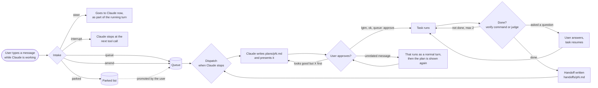
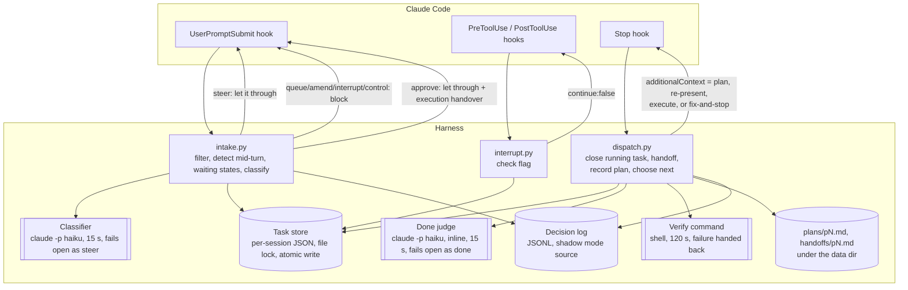
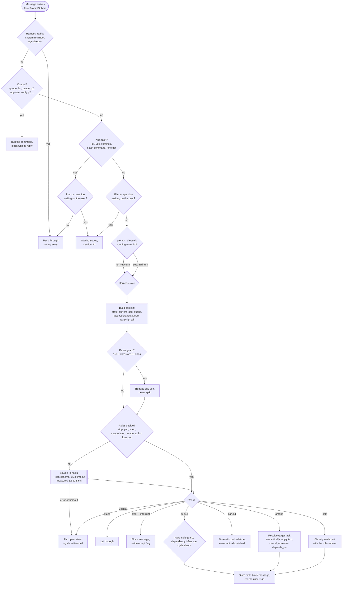
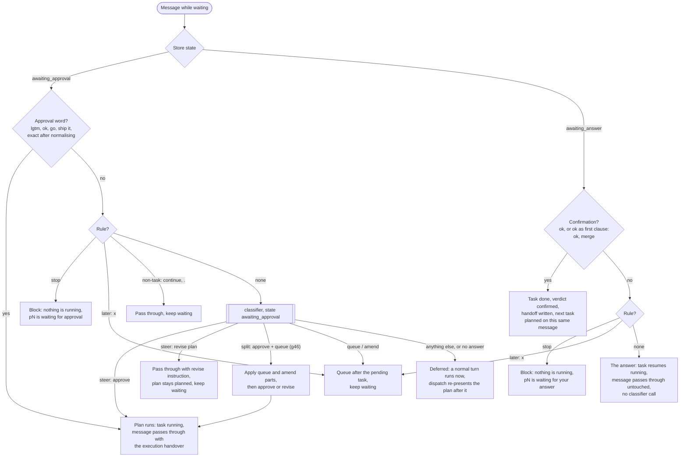
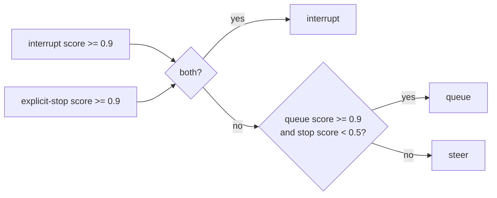
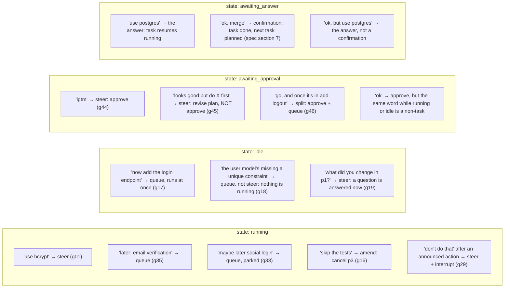
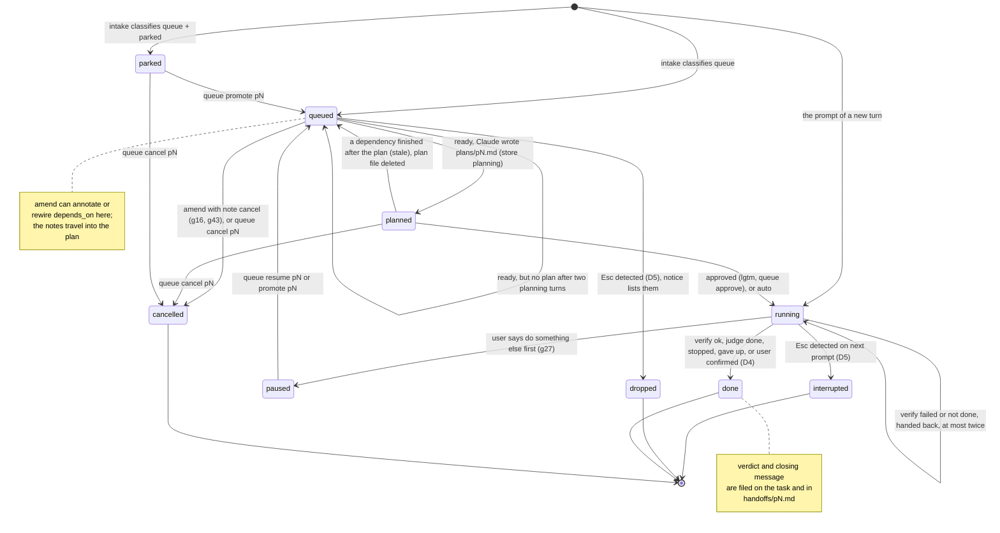
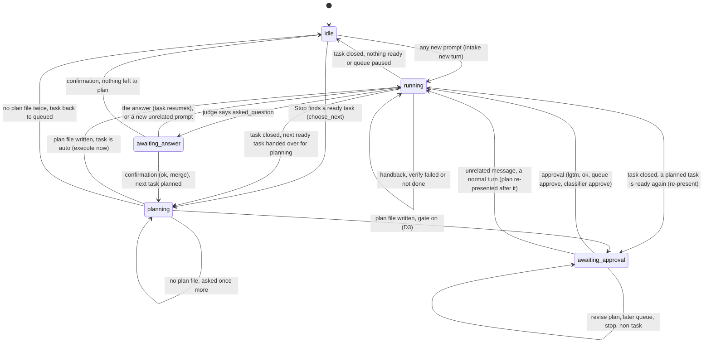
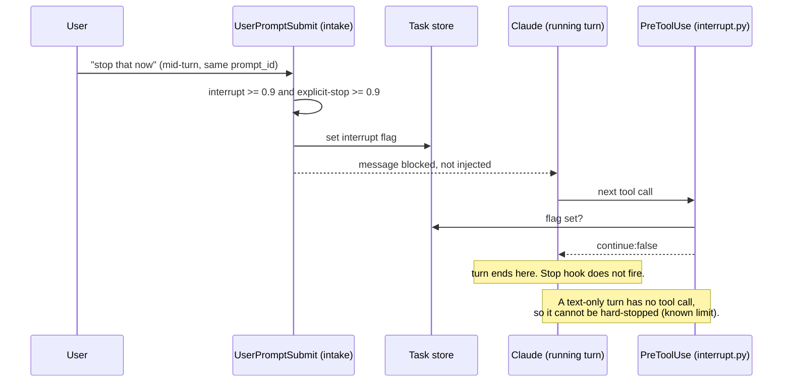
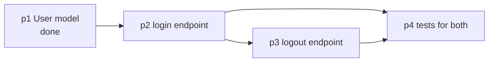

# Flows and core logic

Diagrams for how the harness behaves. GitHub renders the Mermaid blocks inline. The design itself is in [design-spec.md](design-spec.md); the cases that pin down each branch are in [`eval/golden_queue_intake.jsonl`](../eval/golden_queue_intake.jsonl).

## 1. What the user experiences

The user keeps typing while Claude works. Each message lands in one of five places, and the harness tells them which. Plans and handoffs are files under the plugin data dir (`sessions/<session>/plans/pN.md`, `.../handoffs/pN.md`), written and read by the session's own Claude; the harness only tells it which file.



A task marked `auto` (`queue: auto pN`) still gets a plan and a handoff but skips the approval stop: the plan flows straight into execution.

## 2. Where the harness sits

Three Claude Code hooks, one store on disk, one classifier call.



Both model calls go through one wrapper, `qsc/model.py`, with the same isolation flags (`--setting-sources "" --strict-mcp-config --tools ""`), one system prompt each (`prompts/intake_system.md`, `prompts/judge_system.md`) and one JSON schema each.

## 3. Intake: how a message is classified

The rules that run before the model are cheap and deterministic. The model only sees what survives them.



### 3b. Intake while the store waits on the user

Two store states park the session on the user: `awaiting_approval` (a plan for `pending_task` is on screen) and `awaiting_answer` (the running task stopped by asking something). Intake reads the state before the non-task pass-through, so "ok" approves a waiting plan but is still a non-task when nothing waits. Control messages win first in every state.



Interrupt needs two signals, so a stray "stop" inside a longer sentence does not halt the run:



## 4. How state changes what a message means

The same words classify differently depending on what the harness is doing. Cases from the golden set:



## 5. Task lifecycle

Two state machines, kept in one store: each task has a status, and the store as a whole has a state that says what the session is waiting on. "Ready" is not a stored status: a `queued` task whose every `depends_on` is `done` is ready (`Store.ready()`).

### 5a. Task status



`failed_verify` is a status the store, `queue: promote` and `queue: cancel` accept, but nothing sets it yet: a failing verify command is handed back twice and then the task is closed as `done` with verdict `gave_up`.

### 5b. Store state



## 6. Dispatch: what happens each time Claude stops

Three stages, one function each in `dispatch.py`: close the running task (`_close_running`), record the plan a planning turn wrote (`_after_planning`), choose what is next (`choose_next`). Which ones run depends on the store state. Every handover is `hookSpecificOutput.additionalContext`, which keeps the turn alive with that text; a Stop in `awaiting_approval` or `awaiting_answer` changes nothing.

```mermaid
sequenceDiagram
    autonumber
    participant C as Claude Code
    participant S as Stop hook (dispatch.py)
    participant D as done.py (verify or judge)
    participant T as Task store + files
    participant U as User

    C->>S: Stop event (last_assistant_message, cwd, stop_hook_active)
    alt store state running: stage A, close the running task
        S->>D: decide(task, event, plan excerpt)
        alt task has a verify command
            D->>D: run it in cwd, 120 s timeout
        else no verify command
            D->>D: claude -p haiku judge, 15 s, fails open as done
        end
        D-->>S: verdict
        alt verify_failed or not_done, fewer than 2 handbacks
            S-->>C: additionalContext = fix it / finish it, then stop
        else asked_question
            S->>T: state = awaiting_answer, task stays running
            S-->>C: return (the user answers next)
        else done, verify_ok, stopped, gave_up
            S->>T: task done, verdict and closing filed, handoffs/pN.md written
        end
    else store state planning: stage B, after a planning turn
        alt plans/pN.md exists
            S->>T: task planned, plan_based_on = done ids
            alt task is auto
                S-->>C: additionalContext = execute the plan at plans/pN.md
            else gate on (D3)
                S-->>U: state = awaiting_approval, the plan is on screen
                U-->>S: lgtm / revise / unrelated (next message, via intake)
            end
        else no plan file
            S-->>C: ask once more, then task back to queued, state idle
        end
    end
    opt stage D, choose what is next (after A closed a task, or from idle)
        S->>T: state idle; stale planned children back to queued, their plan files deleted
        alt queue paused or shadow mode
            S-->>C: return, nothing handed over
        else a planned task is ready again
            S->>T: state = awaiting_approval
            S-->>C: additionalContext = pN is planned at plans/pN.md, present it and stop
        else a queued task is ready
            S->>S: spin guard: same task as the last continuation? then return
            S->>T: state = planning, pending_task = pN
            S-->>C: additionalContext = read handoffs of depends_on, write plans/pN.md, present it, stop (or carry on if auto)
        else nothing ready
            S-->>C: return, no additionalContext
        end
    end
```

## 7. Interrupt: why it happens at a tool boundary



## 8. Dependency inference, by example

Case g20: "1) login endpoint 2) logout endpoint 3) tests for both", while idle with p1 done.



The naive "depend on the previous task" rule gets this wrong (p4 would depend only on p3). Case g12 is the same trap in the other direction: "after login's done, add logout" depends on p2 (login), not on p3 (tests), even though p3 was queued last.

## 9. Shadow mode

Milestone M0 runs the whole intake path but acts on nothing. The classifier is `claude -p` (decision D2b), so M0 also measures how often the rules decide without it. Every decision goes to the log; messages pass through untouched. Flip one flag to go active.


