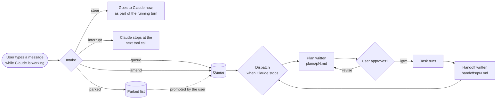
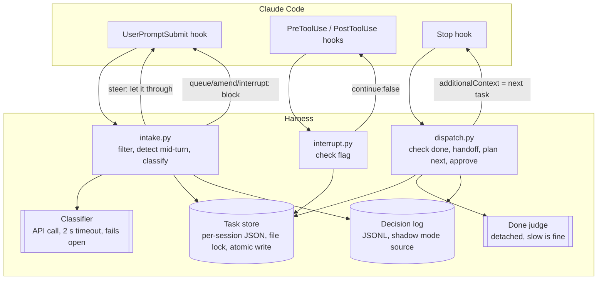
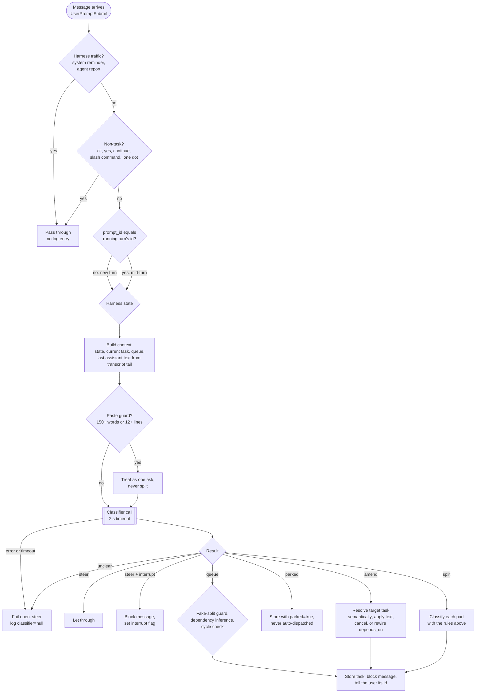
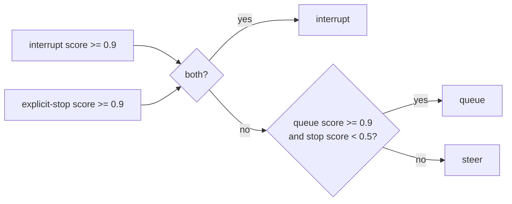
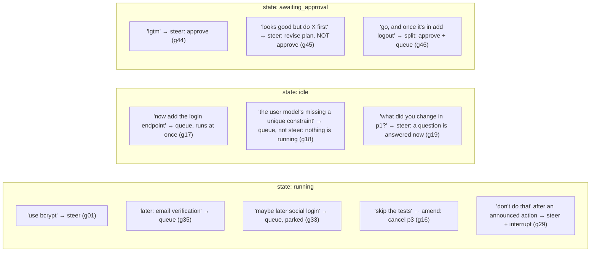
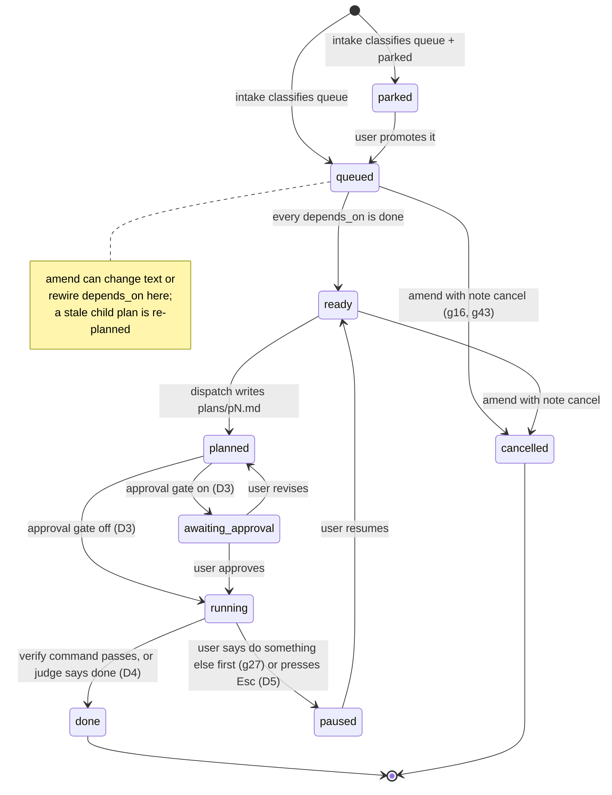
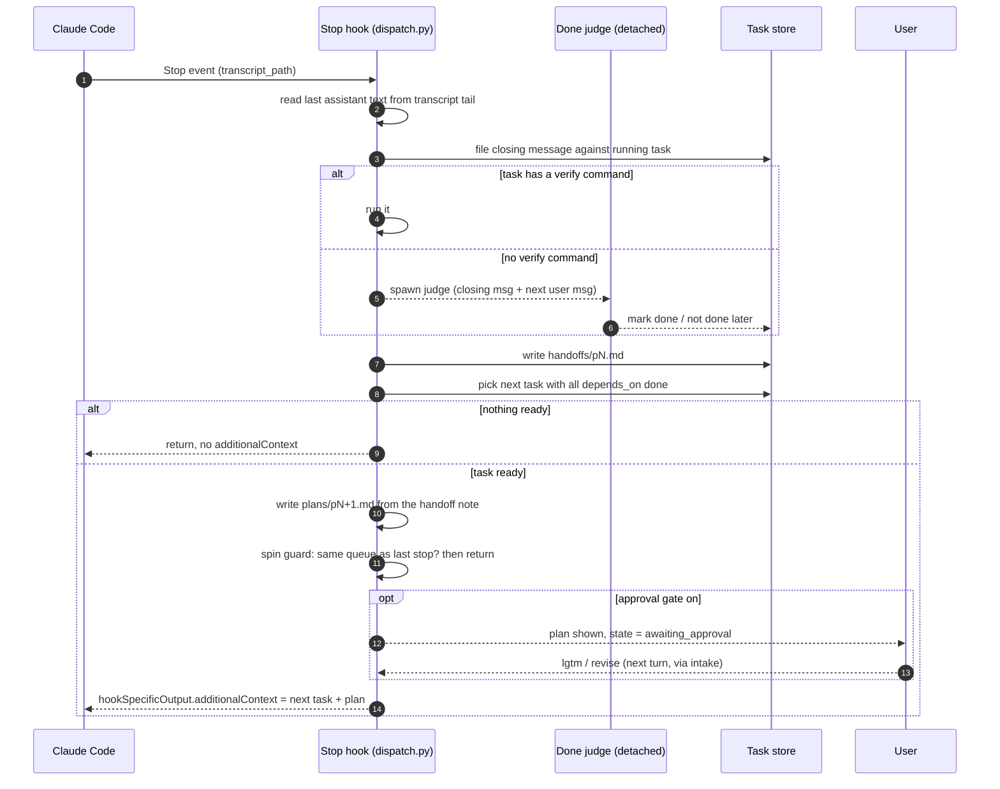
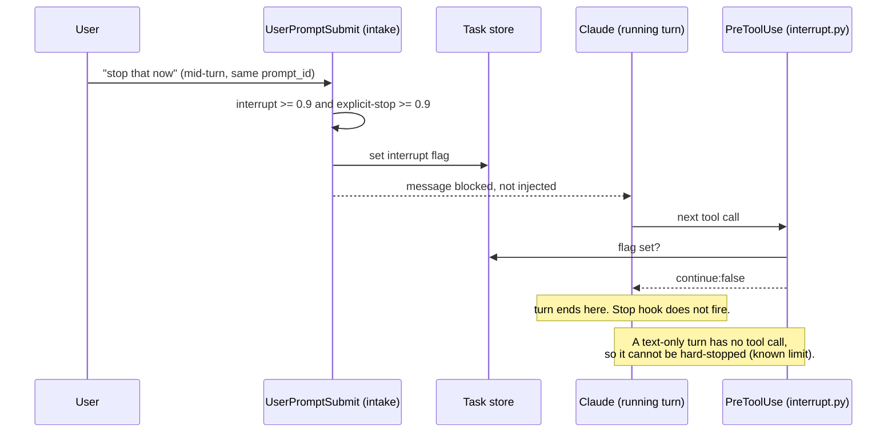
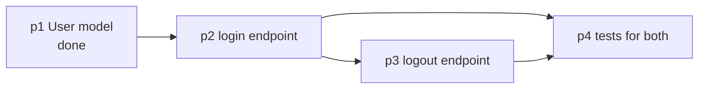
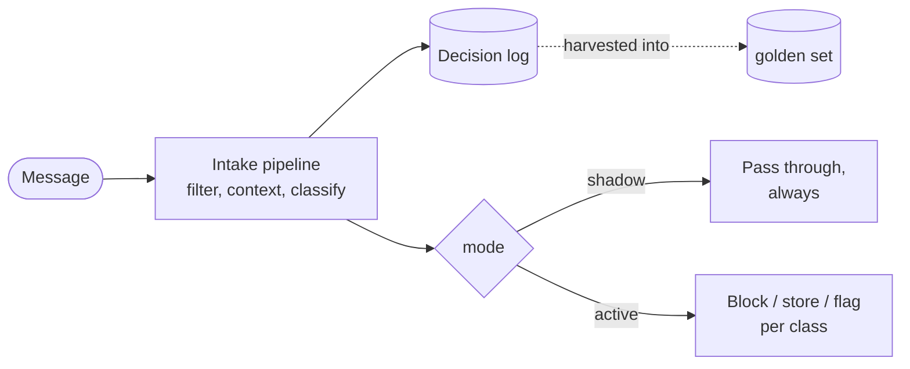

# Flows and core logic

Diagrams for how the harness behaves. GitHub renders the Mermaid blocks inline. The design itself is in [design-spec.md](design-spec.md); the cases that pin down each branch are in [`eval/golden_queue_intake.jsonl`](../eval/golden_queue_intake.jsonl).

## 1. What the user experiences

The user keeps typing while Claude works. Each message lands in one of five places, and the harness tells them which.

## 2. Where the harness sits

Three Claude Code hooks, one store on disk, one classifier call.

## 3. Intake: how a message is classified

The rules that run before the model are cheap and deterministic. The model only sees what survives them.

Interrupt needs two signals, so a stray "stop" inside a longer sentence does not halt the run:

## 4. How state changes what a message means

The same words classify differently depending on what the harness is doing. Cases from the golden set:

## 5. Task lifecycle

## 6. Dispatch: what happens each time Claude stops

## 7. Interrupt: why it happens at a tool boundary

## 8. Dependency inference, by example

Case g20: "1) login endpoint 2) logout endpoint 3) tests for both", while idle with p1 done.

The naive "depend on the previous task" rule gets this wrong (p4 would depend only on p3). Case g12 is the same trap in the other direction: "after login's done, add logout" depends on p2 (login), not on p3 (tests), even though p3 was queued last.

## 9. Shadow mode

Milestone M0 runs the whole intake path but acts on nothing. Every decision goes to the log; messages pass through untouched. Flip one flag to go active.

